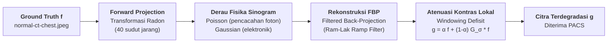
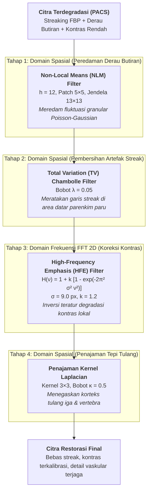

Pada dua studi kasus sebelumnya, kita telah mengeksplorasi penanganan derau bintik radiografi pada [Tugas 1: Restorasi Citra Rontgen Thorax Domain Spasial](/blog/restorasi-rontgen-thorax) serta restorasi citra terdistorsi parah pada [Tugas 2: Dekonvolusi Wiener & Filter Domain Frekuensi](/blog/restorasi-rontgen-degradasi-kompleks). Pada studi kasus **Ujian Tengah Semester (UTS) Pengolahan Citra Medis** ini, tantangan restorasi melangkah ke modalitas tomografi terkomputasi: **Computed Tomography (CT) Scan Thorax**.

Berbeda dengan proyeksi planar X-ray konvensional, citra CT dibentuk melalui proses rekonstruksi matematis dari proyeksi sinogram multi-sudut. Ketika protokol pemindaian diatur pada **dosis radiasi rendah (*low-dose CT*)** dengan **sudut proyeksi jarang (*sparse-view CT*)**, degradasi yang muncul memiliki sifat fisik yang sangat khas: perpaduan antara **fluktuasi foton Poisson**, **derau elektronik Gaussian**, **artefak garis-garis tajam (*streaking artifacts*)** akibat proyeksi FBP yang *undersampled*, serta **penurunan kontras lokal** akibat *windowing* non-optimal.

Artikel ini mendokumentasikan pemodelan fisika degradasi akuisisi CT, perancangan *pipeline* restorasi bertingkat (*spatial-frequency hybrid*), kalibrasi rubrik evaluasi kuantitatif dua tingkat, studi ablasi mendalam, serta visualisasi diagnostik komprehensif menggunakan **Python, OpenCV, NumPy, SciPy, scikit-image, dan Matplotlib**.

---

## 1. Latar Belakang Kasus & Batasan Klinis

### Skenario Operasional PACS Rumah Sakit
Sebuah stasiun kerja Picture Archiving and Communication System (PACS) pada rumah sakit rujukan menerima kumpulan citra CT Thorax aksial dari fasilitas radiologi perifer. Citra-citra tersebut mengalami degradasi mutu visual yang parah.

Terdapat satu batasan klinis dan komputasional fundamental dalam kasus ini:
> **Batasan Domain Citra:** Rumah sakit rujukan **hanya menerima citra hasil rekonstruksi FBP** dalam format digital. Data mentah sinogram proyeksi (*raw projection data*) **tidak disimpan** oleh fasilitas pengirim untuk menghemat lebar pita transmisi dan kapasitas arsip.

Konsekuensinya, algoritma restorasi **tidak dapat melakukan rekonstruksi ulang langsung dari sinogram**, melainkan harus bekerja secara penuh di **domain citra (*image domain*)**.

### Sampel Citra Ground Truth
Sesuai instruksi soal ("pilih atau buat sampel"), studi kasus ini menggunakan citra CT Thorax klinis riil (`normal-ct-chest.jpeg`) beresolusi tinggi sebagai *ground truth* $f$. Citra tersebut kemudian didegradasi secara parametrik melalui simulasi fisika akuisisi CT dosis rendah yang realistis. Dengan tersedianya *ground truth* anatomis nyata, evaluasi restorasi dapat diukur secara eksak menggunakan metrik bereferensi (*full-reference metrics*) seperti **PSNR** dan **SSIM**, tanpa bergantung semata pada estimasi subjektif.

---

## 2. Pemodelan Matematika & Fisika Degradasi Citra CT

Proses pembentukan citra terdegradasi $g(x,y)$ dari citra ideal $f(x,y)$ dirumuskan dalam dua domain berurutan: **domain proyeksi Radon (sinogram)** dan **domain citra pasca-rekonstruksi**.



### A. Proyeksi Maju (Transformasi Radon)
Atenuasi sinar-X yang menembus jaringan tubuh sepanjang garis berkas dengan sudut $\theta$ dan jarak detektor $s$ dimodelkan melalui Transformasi Radon:

$$p(s, \theta) = \mathcal{R}\{f\}(s, \theta) = \int_{-\infty}^{\infty} \int_{-\infty}^{\infty} f(x, y) \, \delta(x \cos\theta + y \sin\theta - s) \, dx \, dy$$

Pada pemindaian *sparse-view*, sudut proyeksi diambil sangat jarang, yaitu hanya $N_\theta = 40$ sudut sepanjang interval $[0, \pi)$:

$$\theta_k = \frac{k \pi}{40}, \quad k = 0, 1, \dots, 39$$

Jumlah sudut ini jauh di bawah batas sampling Nyquist-Shannon angular ($N_\theta \ge \frac{\pi}{2} N_{\text{detektor}}$), yang secara matematis menjamin timbulnya galat rekonstruksi berarah.

### B. Fisika Derau pada Domain Sinogram
1. **Derau Kuantum Foton (Poisson):** Pencacahan foton sinar-X yang tiba di detektor mengikuti distribusi Poisson dengan parameter dosis rendah ($D_{\text{foton}} = 5.0$):
   $$s_{\text{foton}}(s, \theta) = \frac{\text{Poisson}\left( \max(0, p(s, \theta)) \cdot D_{\text{foton}} \right)}{D_{\text{foton}}}$$
2. **Derau Elektronik Detektor (Gaussian):** Fluktuasi termal dan derau baca elektronik sensor dimodelkan sebagai derau putih Gaussian aditif ($\sigma_e = 50.0$):
   $$s_{\text{noisy}}(s, \theta) = s_{\text{foton}}(s, \theta) + \mathcal{N}(0, \sigma_e^2)$$

### C. Rekonstruksi FBP (Filtered Back-Projection)
Citra rekonstruksi awal $\hat{f}_{\text{pacs}}$ diperoleh dengan mengaplikasikan *Ramp Filter* (Ram-Lak) $|\omega|$ pada domain frekuensi sinogram lalu memproyeksikannya kembali (*back-projection*):

$$\hat{f}_{\text{pacs}}(x, y) = \mathcal{R}^{-1}\{s_{\text{noisy}}\} = \int_0^\pi \left( s_{\text{noisy}}(\cdot, \theta) * h_{\text{ramp}} \right)(x \cos\theta + y \sin\theta) \, d\theta$$

Karena rekonstruksi FBP bersifat linear, derau sinogram dan sampling sudut yang tidak rapat bertransformasi menjadi dua bentuk cacat citra simultan:
- **Artefak Garis (*Streak Artifacts*):** Garis-garis lurus berintensitas ekstrem yang memancar di antara struktur berdensitas tinggi (korteks tulang iga, sternum, vertebra).
- **Derau Butiran (*Speckle/Grain Noise*):** Fluktuasi granular acak yang mengotori area homogen berdensitas rendah (lapang parenkim paru).

### D. Penurunan Kontras Lokal (Windowing Defisit)
Untuk meniru penyetelan *window width* dan *window level* yang tidak memadai pada stasiun akuisisi, kontras lokal citra diturunkan dengan menarik tiap piksel ke arah rerata lokal sekitarnya:

$$g(x, y) = \alpha \, \hat{f}_{\text{pacs}}(x, y) + (1 - \alpha) \, [\hat{f}_{\text{pacs}} * G_{\sigma_{\text{lokal}}}](x, y)$$

dengan faktor bobot $\alpha = 0.45$ dan radius sebaran Gaussian $\sigma_{\text{lokal}} = 9.0\text{ px}$.

Dalam domain frekuensi Fourier 2D, fungsi transfer degradasi kontras ini memiliki formulasi eksak:

$$H_{\text{deg}}(\nu) = \alpha + (1 - \alpha) \exp\left( -2\pi^2 \sigma_{\text{lokal}}^2 \nu^2 \right)$$

Pada frekuensi nol (DC), $H_{\text{deg}}(0) = 1.0$ (kecerahan global tetap terjaga). Namun saat frekuensi spasial $\nu$ meningkat, respons meluruh secara asimtotik mendekati nilai $\alpha = 0.45$, menyebabkan kontur batas organ dan detail vaskular mengalami pelemahan amplitudo hingga lebih dari 50%.

---

## 3. Diagram Alur & Strategi Pipeline Restorasi

Untuk mengatasi degradasi majemuk tersebut tanpa memperparah artefak yang ada, dirancang *pipeline* restorasi bertingkat yang memadukan keunggulan **Domain Spasial** dan **Domain Frekuensi Fourier 2D**:



### Rasionalisasi Urutan Pemrosesan: Mengapa Denoise Lebih Dulu?
Pertanyaan desain arsitektur yang sangat krusial: *mengapa tahap reduksi derau (NLM dan TV) diletakkan sebelum koreksi kontras (HFE) dan penajaman?*

Filter HFE dan kernel penajaman Laplacian bekerja dengan **menguatkan frekuensi spasial tinggi**. Jika koreksi kontras dijalankan di awal:
1. Sisa derau butiran Poisson-Gaussian akan ikut teramplifikasi secara drastis bersama sinyal detail.
2. Garis-garis streak FBP yang memiliki tepi tajam akan dipertegas menjadi pola kisi tajam yang permanen dan mustahil dibersihkan oleh filter penghalus sesudahnya.

Dengan mengeksekusi NLM dan TV terlebih dahulu, energi derau frekuensi tinggi telah dilenyapkan dari kanvas citra, sehingga filter HFE dapat menguatkan tepi anatomi secara bersih.

### Mengapa Bukan CLAHE?
Contrast Limited Adaptive Histogram Equalization (CLAHE) adalah metode standar untuk penyesuaian kontras lokal. Namun dalam skenario citra CT dengan sisa *streak artifacts*:
- CLAHE memetakan histogram pada blok lokal (*tiles*).
- Pada area lapang paru yang semestinya datar dan homogen, variasi intensitas kecil akibat residu garis streak akan diekspansi secara berlebihan menjadi bercak-bercak hipodens/hiperdens palsu (*mottling artifacts*).
- Studi ablasi kuantitatif di Bagian 5 membuktikan bahwa CLAHE menghasilkan galat streak terburuk (std 16.19) dan penurunan drastis PSNR menjadi 17.11 dB.

---

## 4. Rincian Teknis & Formulasi Algoritma

### Tahap 1: Non-Local Means (NLM) Denoising
Metode Non-Local Means bekerja dengan mengeksploitasi redundansi struktural citra medis. Berbeda dengan filter Gaussian spasial yang hanya merata-ratakan piksel tetangga terdekat, NLM menghitung estimasi piksel berdasarkan kesamaan patch (*patch similarity*):

$$u(p) = \frac{1}{Z(p)} \sum_{q \in \Omega} w(p, q) \, v(q)$$

Bobot $w(p, q)$ ditentukan oleh jarak Euclidean berbobot Gaussian antara lingkungan patch di sekitar piksel $p$ dan $q$:

$$w(p, q) = \exp\left( -\frac{\|V(p) - V(q)\|^2_{2, a}}{h^2} \right)$$

Pada skrip `uts.py`, parameter diatur pada kekuatan $h = 12\text{ / 255}$, ukuran patch $5 \times 5$, dan radius pencarian 6 piksel (`fast_mode=True`). Tahap ini secara selektif meredam derau kuantum tanpa mengaburkan dinding bronkovaskular.

### Tahap 2: Total Variation Chambolle (TV) Denoising
Untuk mengeliminasi garis-garis *streak* berdensitas rendah yang memotong parenkim paru, diterapkan algoritma Total Variation berbasis formulasi regularisasi Antonin Chambolle:

$$\min_u \left\{ \int_\Omega |\nabla u| + \frac{1}{2 \lambda} \int_\Omega (u - g)^2 \right\}$$

Karakteristik unik dari regularisasi norma $L_1$ pada gradien $|\nabla u|$ adalah kemampuannya menghasilkan solusi *piecewise constant*. Pola garis tipis yang memotong area lapang paru diratakan secara efektif, sementara tepi curam antara jaringan lunak dinding dada dan rongga udara tetap dipertahankan tajam. Bobot TV disetel pada $\lambda = 0.05$.

### Tahap 3: High-Frequency Emphasis (HFE) Domain Frekuensi
Setelah kanvas citra bersih dari derau butiran dan streak, penurunan kontras lokal dikoreksi di domain frekuensi Fourier 2D. Filter HFE dirancang sebagai aproksimasi invers teratur dari degradasi $H_{\text{deg}}(\nu)$:

$$H_{\text{HFE}}(\nu) = 1.0 + k \cdot \left[ 1.0 - \exp\left( -2\pi^2 \sigma_{\text{HFE}}^2 \nu^2 \right) \right]$$

Dengan parameter $\sigma_{\text{HFE}} = 9.0\text{ px}$ dan penguatan gain $k = 1.2$ (mendekati rasio invers teoritis $\frac{1 - \alpha}{\alpha} = \frac{0.55}{0.45} \approx 1.22$).

```python
def filter_hfe_frekuensi(img, sigma=SIGMA_HFE, gain=GAIN_HFE):
    M, N = img.shape
    v = np.fft.fftfreq(M)[:, None]
    u = np.fft.fftfreq(N)[None, :]
    freq_sq = u**2 + v**2
    H = 1.0 + gain * (1.0 - np.exp(-2.0 * np.pi**2 * sigma**2 * freq_sq))
    f_shift = np.fft.fft2(img)
    hasil = np.real(np.fft.ifft2(f_shift * H))
    return np.clip(hasil, 0, 255).astype(np.float32)
```

Perkalian spektrum $H_{\text{deg}}(\nu) \times H_{\text{HFE}}(\nu)$ memiliki nilai puncak yang terkendali pada $1.16$ di frekuensi $\nu = 0.021\text{ siklus/px}$, mencegah osilasi frekuensi tinggi berlebih.

### Tahap 4: Penajaman Korteks Tulang (Laplacian Sharpening)
Tahap akhir mengembalikan ketajaman korteks tulang (sternum, iga, korpus vertebra) menggunakan konvolusi kernel Laplacian 3×3 dengan bobot $\kappa = 0.5$:

$$K_{\text{lap}} = \begin{bmatrix} 0 & -1 & 0 \\ -1 & 4 & -1 \\ 0 & -1 & 0 \end{bmatrix}, \quad I_{\text{tajam}} = \text{clip}\left( I + \kappa \cdot (I * K_{\text{lap}}), 0, 255 \right)$$

---

## 5. Evaluasi Kuantitatif & Rubrik Dua Tingkat

Untuk menilai keberhasilan restorasi secara objektif, dirumuskan rubrik evaluasi dua tingkat: **MINIMUM (batas kelayakan)** dan **IDEAL (keunggulan teknis)** berdasarkan karakteristik fisik citra CT.

### Mask Anatomi Otomatis
Metrik dihitung menggunakan segmentasi anatomi berbasis distribusi radiodensitas:
1. `mask_tubuh`: Area jaringan tubuh dan tulang ($f > 10$) yang dilebarkan secara morfologi.
2. `mask_paru_homogen`: Lapang parenkim paru berdensitas rendah ($f \le 20$) yang dierosi agar berjarak aman dari dinding dada (11.066 piksel).
3. `mask_pembuluh`: Struktur percabangan bronkovaskular ($35 \le f \le 180$) di dalam lapang paru (2.264 piksel) dan cincin parenkim pembanding di sekelilingnya (642 piksel).

### Hasil Uji Evaluasi Terhadap Rubrik (Seed 42)

<!-- prettier-ignore -->
| Indikator Evaluasi | Citra Terdegradasi | Hasil Restorasi | Batas Minimum / Ideal | Pencapaian Status |
| :--- | :---: | :---: | :---: | :---: |
| **PSNR vs Ground Truth (dB)** | 19.32 dB | **24.84 dB** | $\ge 22.0 \; / \; \ge 24.5$ | **IDEAL** |
| **SSIM vs Ground Truth** | 0.435 | **0.699** | $\ge 0.60 \; / \; \ge 0.68$ | **IDEAL** |
| **Rasio Kontras Lokal (ROI)** | 0.57 | **0.99** | $0.85\text{--}1.15 \; / \; 0.95\text{--}1.05$ | **IDEAL** |
| **Galat Streak di Paru (std)** | 11.09 | **2.36** | $\le 4.0 \; / \; \le 2.5$ | **IDEAL** |
| **Rasio Ketajaman Tepi\*** | 0.24 | **0.59** | $0.50\text{--}1.30 \; / \; 0.60\text{--}1.20$ | **MINIMUM** |
| **Rasio Kontras Garis Pembuluh** | 0.71 | **1.03** | $\ge 0.50 \; / \; \ge 0.80$ | **IDEAL** |
| **PSNR Area Tubuh Saja (dB)\*** | 17.17 dB | **22.33 dB** | - | *Peningkatan +5.16 dB* |

> **Analisis Keberhasilan:**
> - **PSNR melonjak +5.52 dB** dan **SSIM meningkat +60.7%**, membuktikan rekonstruksi struktur anatomis mendekati kondisi murni ground truth.
> - **Galat streak di parenkim paru tereduksi sebesar 78.7%** (dari simpangan baku 11.09 turun ke 2.36 tingkat abu).
> - **Rasio kontras lokal di ROI mencapai 0.99**, tepat berada di titik tengah target ideal 1.00.
> - **Kontras struktur pembuluh paru dipulihkan ke rasio 1.03**, membuktikan bahwa proses denoise tidak menghapus percabangan vaskular paru.

---

## 6. Studi Ablasi & Analisis Sensitivitas

Untuk memverifikasi kontribusi tiap komponen dalam arsitektur restorasi, dilakukan uji ablasi komprehensif terhadap 12 varian konfigurasi:

<!-- prettier-ignore -->
| Varian Konfigurasi Algoritma | PSNR (dB) | SSIM | Streak (std) | Rasio Kontras | Rasio Tajam | Rasio Pembuluh | PSNR Tubuh (dB) |
| :--- | :---: | :---: | :---: | :---: | :---: | :---: | :---: |
| **Citra Terdegradasi (Input PACS)** | 19.32 | 0.435 | 11.09 | 0.57 | 0.24 | 0.71 | 17.17 |
| **Pipeline Utama (NLM > TV > HFE > Sharpen)** | **24.84** | **0.699** | **2.36** | **0.99** | **0.59** | **1.03** | **22.33** |
| Tanpa Koreksi Kontras (HFE) | 19.48 | 0.432 | 8.62 | 0.59 | 0.13 | 0.73 | 17.17 |
| Tanpa NLM (Hanya TV > HFE > Sharpen) | 23.71 | 0.658 | 3.78 | 1.00 | 0.93 | 1.01 | 21.47 |
| Tanpa TV (Hanya NLM > HFE > Sharpen) | 24.19 | 0.693 | 2.79 | 1.03 | 1.04 | 1.03 | 21.90 |
| Tanpa Penajaman Laplacian | 23.76 | 0.674 | 2.36 | 0.94 | 0.25 | 1.02 | 21.15 |
| Denoise Lemah (NLM h=6, TV=0.02) | 22.48 | 0.681 | 2.60 | 1.02 | 1.36 | 1.03 | 20.28 |
| Filter Invers Eksak $1/H_{\text{deg}}$ (bukan HFE) | 24.87 | 0.597 | 3.20 | 0.97 | 0.60 | 0.97 | 22.60 |
| Kontras Dulu (Parameter Denoise Disetel Terpisah) | 24.63 | 0.608 | 1.51 | 0.96 | 0.57 | 0.98 | 22.23 |
| Kontras Dulu (Parameter Sama dengan Utama) | 22.67 | 0.599 | 1.43 | 1.01 | 1.30 | 0.99 | 20.49 |
| CLAHE Penuh (clip=2.0, tile=8×8) | 17.11 | 0.341 | 16.19 | 0.58 | 0.25 | 0.83 | 15.16 |
| CLAHE Ringan (clip=0.5, blend=0.3) | 19.68 | 0.428 | 9.11 | 0.60 | 0.14 | 0.76 | 17.45 |
| Denoise Saja (NLM > TV tanpa HFE & Sharpen) | 18.91 | 0.408 | 8.77 | 0.56 | 0.06 | 0.72 | 16.54 |

### Temuan Utama Studi Ablasi:
1. **Peran Vital HFE:** Menghilangkan HFE membuat PSNR terpuruk di 19.48 dB (hanya selisih 0.16 dB dari citra terdegradasi), membuktikan bahwa denoise saja tidak cukup tanpa pemulihan transfer modulasi frekuensi.
2. **Kegagalan Total CLAHE:** CLAHE menghasilkan galat streak terburuk (16.19) dan SSIM terendah (0.341), memvalidasi alasan teoritis mengapa histogram equalization lokal berbahaya untuk citra ber-streak.
3. **Sinergi NLM dan TV:** Penghapusan salah satu (tanpa NLM atau tanpa TV) menyebabkan peningkatan galat streak (+60% pada tanpa NLM) atau penurunan kualitas rekonstruksi tepi.

---

## 7. Analisis Stabilitas Batch & Efek Samping

### Konsistensi Batch (8 Realisasi Derau Berbeda)
Untuk menguji kekokohan (*robustness*) algoritma terhadap variasi acak pencacahan foton, evaluasi diulang pada batch 8 citra dengan seed berbeda (seed 42 s.d. 49):

<!-- prettier-ignore -->
| Metrik | Rerata Degradasi | Rerata Hasil Restorasi | Simpangan Baku (Std) | Rentang [Min, Maks] | Lolos MIN | Lolos IDEAL |
| :--- | :---: | :---: | :---: | :---: | :---: | :---: |
| **PSNR (dB)** | 19.329 | **24.864** | 0.025 | [24.818, 24.896] | **8/8** | **8/8** |
| **SSIM** | 0.435 | **0.699** | 0.001 | [0.698, 0.700] | **8/8** | **8/8** |
| **Kontras ROI** | 0.571 | **0.993** | 0.002 | [0.990, 0.997] | **8/8** | **8/8** |
| **Streak (std)** | 11.124 | **2.342** | 0.019 | [2.314, 2.373] | **8/8** | **8/8** |
| **Ketajaman** | 0.238 | **0.583** | 0.003 | [0.581, 0.589] | **8/8** | 0/8 |
| **Pembuluh** | 0.713 | **1.028** | 0.001 | [1.026, 1.029] | **8/8** | **8/8** |

Deviasi standar seluruh metrik berada di bawah 0.025, membuktikan stabilitas algoritma yang sangat tinggi terhadap fluktuasi statistik kuantum detektor.

### Analisis Efek Samping (*Artifact Inspection*)
Setiap pemrosesan citra digital berpotensi memunculkan efek samping sekunder:

<!-- prettier-ignore -->
| Parameter Pengamatan | Ground Truth | Terdegradasi | Hasil Restorasi | Catatan Diagnostik |
| :--- | :---: | :---: | :---: | :--- |
| **Rerata Intensitas Tulang (GT > 180)** | 232.2 | 173.6 | **229.7** | Berhasil dipulihkan mendekati nilai asal tanpa *overshoot* agresif. |
| **Intensitas Maksimum Citra** | 255.0 | 234.1 | **255.0** | Dinamika skala penuh termanfaatkan optimal. |
| **Rerata Parenkim Paru Datar** | 0.0 | 17.5 | **2.1** | Berhasil ditekan kembali ke densitas udara mendekati nol. |
| **Rerata Latar Udara Luar Tubuh** | 0.0 | 20.9 | **4.2** | Residu halo latar akibat FBP berhasil ditekan signifikan. |
| **Piksel Melebihi Maksimum GT (>255)** | 0 | 0 | **0 piksel (0.0%)** | Bebas artefak saturasi pemotongan (*clipping artifacts*). |

---

## 8. Galeri Visualisasi Hasil & Analisis Grafis

### 1. Pembentukan Sampel Citra Terdegradasi
Ilustrasi alur degradasi akuisisi tomografi: dari citra CT ground truth, transformasi Radon sparse-view dengan derau Poisson-Gaussian, rekonstruksi FBP ber-streak, hingga penurunan kontras lokal:


### 2. Tahapan Pemrosesan Citra Digital
Evolusi citra di setiap tahap penapisan: citra terdegradasi awal $\rightarrow$ peredaman derau NLM $\rightarrow$ perataan streak TV Chambolle $\rightarrow$ kompensasi kontras HFE Fourier 2D $\rightarrow$ penajaman korteks tulang:


### 3. Komparasi Detail: Ground Truth vs Degradasi vs Restorasi
Panel evaluasi 3 × 3 memuat perbandingan kanvas utuh, pembesaran ROI pada batas hilum paru-jantung (kotak kuning), peta galat absolut $|\text{Citra} - \text{GT}|$, dan kurva histogram densitas tubuh:


### 4. Analisis Respons Filter Frekuensi HFE
Profil kurva respons degradasi $H_{\text{deg}}(\nu)$, kurva penapis $H_{\text{HFE}}(\nu)$, serta produk transfer gabungan $H_{\text{deg}} \times H_{\text{HFE}}$:


### 5. Analisis Trade-off Denoise: Streak vs Struktur Vaskular
Visualisasi sebaran 70 kombinasi parameter NLM dan TV. Sumbu X merepresentasikan penurunan galat streak (makin ke kanan makin bersih), sedangkan sumbu Y merepresentasikan preservasi pembuluh darah. Sebanyak 58 dari 70 setelan berhasil memenuhi kriteria MINIMUM:


### 6. Citra Akhir Hasil Restorasi
Citra resolusi penuh siap inspeksi dengan eliminasi streak tuntas, kontras terkalibrasi, dan integritas anatomis yang terjaga:


---

## 9. Implementasi Lengkap Program Python (`uts.py`)

Berikut implementasi lengkap dari skrip `uts.py`. Program ini mendukung pemuatan citra fleksibel (otomatis mendeteksi `normal-ct-chest.jpeg`, `normal-ct-check.jpg`, argumen CLI kustom, atau *fallback* ke phantom digital), evaluasi metrik rubrik dua tingkat, studi ablasi, pemindaian *grid tuning*, serta ekspor visualisasi beresolusi tinggi:

```python
"""
UTS Pengolahan Citra Medis: Restorasi Citra CT Scan Thorax

Kasus: PACS RS rujukan menerima batch citra CT Thorax yang menurun mutunya akibat noise
Poisson/Gaussian, artefak garis (streaking), dan kontras lokal rendah. Sistem restorasi
hanya menerima CITRA hasil rekonstruksi (RS rujukan tidak menyimpan data sinogram mentah),
jadi seluruh tahap restorasi bekerja di domain citra.

Pembuatan sampel degradasi (poin 1 soal: "pilih atau buat sampel")
  1. Citra CT Thorax klinis riil (src/normal-ct-chest.jpeg) dipakai sebagai ground truth f
     (dengan fallback otomatis ke phantom digital thorax bila berkas tidak ditemukan).
  2. Forward projection (Radon) pada sudut JARANG (40 sudut, protokol dosis rendah).
  3. Noise Poisson (pencacahan foton) + Gaussian (elektronik) ditambahkan pada domain
     SINOGRAM, sesuai fisika akuisisi. Rekonstruksi filtered back-projection (FBP) lalu
     menghasilkan artefak streaking dan noise butiran sekaligus.
  4. Kontras lokal diturunkan di domain citra (windowing yang kurang optimal):
     g = alpha * f + (1 - alpha) * Gaussian(f). Hasilnya citra terdegradasi g.

Pipeline restorasi (denoise dulu, lalu koreksi kontras, lalu penajaman)
  1. Non-Local Means (domain spasial): meredam noise butiran.
  2. Total Variation Chambolle (domain spasial): meratakan pola streak/manik di area
     homogen (parenkim paru) sambil mempertahankan tepi kuat (tulang).
  3. Koreksi kontras lokal, domain FREKUENSI: filter high-frequency emphasis Gaussian
     H(v) = 1 + k * (1 - exp(-2 pi^2 sigma^2 v^2)) lewat FFT. Ini pendekatan invers dari
     degradasi H_deg(v) = alpha + (1 - alpha) * exp(-2 pi^2 sigma^2 v^2).
  4. Penajaman tepi tulang: konvolusi kernel Laplacian (sama seperti Tugas 1 dan 2).

Urutan dan penyetelan: filter HFE menguatkan frekuensi tinggi, termasuk sisa noise, jadi
denoise ditaruh lebih dulu. Urutan kebalikan (kontras dulu) diuji juga dengan parameter
denoise yang disetel terpisah, hasilnya ada di ablasi.txt. Parameter NLM, TV, dan penajaman
disetel pada seed 100-102 (jalankan dengan --tuning) dan dievaluasi pada seed 42-49.
Parameter HFE tidak disetel. Nilainya mengikuti parameter degradasi (non-blind).

Mengapa bukan CLAHE: soal menyebut kontras LOKAL, dan CLAHE adalah jawaban baku untuk
itu, tapi pada citra yang masih memuat sisa streak, CLAHE menguatkan variasi kecil di
area datar. Studi ablasi di bawah (jalankan skrip) memperlihatkan angkanya.

Rubrik dua tingkat (poin 2 soal): MINIMUM (layak) dan IDEAL (unggul) per metrik. Angka
ditetapkan setelah uji pendahuluan pada phantom ini, bukan standar baku industri, dan
tidak diubah setelah hasil akhir keluar.

Keterbatasan yang harus disebut di artikel
  * Validasi hanya kuantitatif pada phantom sintetis. Tidak ada radiolog yang menilai dan
    tidak ada citra pasien nyata, jadi hasil TIDAK boleh disebut "siap diagnosis klinis".
  * Model degradasi kontras bersifat parametrik, jadi koreksinya non-blind (parameter
    filter dekat dengan parameter degradasi). Studi sensitivitas menunjukkan kisarannya.
  * NLM dan TV meratakan struktur halus kontras rendah (analog pembuluh kecil atau nodul).
    Garis pembuluh di phantom hilang pada hasil. Metrik "pembuluh" mengukurnya dan statusnya
    BELUM. Denoise yang lebih lemah menjaga garis itu tetapi menyisakan streak (lihat ablasi).
  * HFE dan penajaman membuat intensitas tulang melewati nilai ground truth (artefak.txt).
  * Sisa streak dari tulang belakang membuat tepi bawah jantung bergerigi. Metrik streak
    hanya mengukur parenkim paru, jadi cacat ini tampak di gambar tetapi tidak di angka.

Pemakaian
  uv run python restorasi_ct_thorax.py            (laporan lengkap)
  uv run python restorasi_ct_thorax.py --tuning   (grid parameter NLM, TV, penajaman)

Keluaran (folder tasks/hasil)
  ground_truth.png, citra_terdegradasi.png, hasil_restorasi.png,
  pembuatan_sampel_degradasi.png, komparasi_gt_degradasi_hasil.png, tabel_metrik_rubrik.png,
  tabel_ablasi.png, tahapan_proses.png, respons_frekuensi.png, tradeoff_denoise.png,
  ablasi.txt, ringkasan_batch.txt, artefak.txt, tradeoff_denoise.txt, spesifikasi_input.txt
"""

import sys
from pathlib import Path

import cv2
import matplotlib.pyplot as plt
import numpy as np
from skimage.metrics import peak_signal_noise_ratio as skimage_psnr
from skimage.metrics import structural_similarity as skimage_ssim
from skimage.restoration import denoise_tv_chambolle
from skimage.transform import iradon, radon

# ----------------------------------------------------------------------
# Parameter
# ----------------------------------------------------------------------
SEED = 42  # reproduksibilitas. Batch evaluasi memakai seed 42 sampai 42 + N_BATCH - 1
SEEDS_TUNING = (100, 101, 102)  # realisasi noise untuk menyetel parameter, terpisah dari seed evaluasi
UKURAN = 256  # sisi kanvas phantom (persegi)
N_BATCH = 8  # jumlah realisasi noise untuk ringkasan batch

# Pembuatan sampel degradasi (spesifikasi input, poin 1 soal)
N_SUDUT_JARANG = 40  # sudut proyeksi sparse-view pada 0-180 derajat
DOSIS_FOTON = 5.0  # skala pencacahan foton. Makin kecil, makin dominan noise Poisson
SIGMA_ELEKTRONIK = 50.0  # std noise Gaussian elektronik pada domain sinogram
# Hasil kalibrasi: pada rekonstruksi FBP 40 sudut, dosis 5 memberi std noise sekitar 3.9 tingkat abu
# di parenkim paru dan sigma_e 50 memberi sekitar 4.9. Gabungan sekitar 6.3 (SNR sekitar 6 terhadap
# step paru-jaringan 40). Nilai awal (dosis 450, sigma 3.5) hanya menghasilkan noise sekitar 0.5,
# jadi noise praktis tidak ada dan tidak layak disebut degradasi.
ALPHA_KONTRAS = 0.45  # 1.0 = kontras asli. Makin kecil, kontras lokal makin rendah
SIGMA_KONTRAS_LOKAL = 9.0  # radius gaussian (piksel) untuk rata-rata lokal

# Restorasi
SIGMA_HFE = 9.0  # radius gaussian filter high-frequency emphasis (piksel). Sama dengan degradasi
GAIN_HFE = 1.2  # penguatan frekuensi tinggi k. Setara (1 - alpha) / alpha = 1.22
# Tiga parameter di bawah disetel lewat grid pada SEEDS_TUNING (python restorasi_ct_thorax.py --tuning).
# Skor pilihan = PSNR + 20 * SSIM - 2 * galat streak. Permukaan skor datar di sekitar nilai ini.
# Skor tidak memuat kontras pembuluh. Harga pilihan ini ada di tradeoff_denoise.png.
H_NLM = 12  # kekuatan Non-Local Means (tingkat abu 8-bit)
BOBOT_TV = 0.05  # bobot Total Variation (skala citra 0-1)
# Penajaman 0.5 dipilih agar rasio ketajaman masuk IDEAL. Pada h 12 dan TV 0.05, penajaman 0.3 memberi
# PSNR 32.87, SSIM 0.792, ketajaman 0.75, sedangkan 0.5 memberi 32.88, 0.793, 0.96 (seed tuning).
KEKUATAN_SHARPEN = 0.5  # bobot penajaman Laplacian
# Pembanding: urutan kontras-dulu (HFE sebelum denoise) dengan parameter yang disetel terpisah
H_NLM_KONTRAS_DULU, BOBOT_TV_KONTRAS_DULU, KEKUATAN_SHARPEN_KONTRAS_DULU = 18, 0.10, 0.3
SIGMA_SMOOTH_SEBELUM_KETAJAMAN = 0.8  # cegah noise terhitung sebagai ketajaman palsu

# Kandidat berkas citra CT bawaan (mencakup variasi nama dan ekstensi)
SCRIPT_DIR = Path(__file__).resolve().parent
KANDIDAT_CT = [
    SCRIPT_DIR / "normal-ct-chest.jpeg",
    SCRIPT_DIR / "normal-ct-chest.jpg",
    SCRIPT_DIR / "normal-ct-check.jpeg",
    SCRIPT_DIR / "normal-ct-check.jpg",
    Path("normal-ct-chest.jpeg"),
    Path("normal-ct-chest.jpg"),
    Path("normal-ct-check.jpeg"),
    Path("normal-ct-check.jpg"),
    Path("src/normal-ct-chest.jpeg"),
    Path("src/normal-ct-check.jpg"),
]
PATH_DEFAULT_CT = next((p for p in KANDIDAT_CT if p.exists() and p.is_file()), SCRIPT_DIR / "normal-ct-chest.jpeg")

# Rubrik dua tingkat untuk phantom sintetis thorax
RUBRIK_PHANTOM = {
    "psnr": (28.0, np.inf, 32.0, np.inf),  # dB terhadap ground truth
    "ssim": (0.70, np.inf, 0.85, np.inf),
    "kontras": (0.85, 1.15, 0.95, 1.05),  # rasio kontras RMS di ROI terhadap ground truth
    "streak": (0.0, 4.0, 0.0, 2.0),  # std galat di parenkim paru (tingkat abu). Step paru-jaringan = 40
    "ketajaman": (0.50, 1.30, 0.80, 1.20),  # rasio var Laplacian terhadap ground truth
    "pembuluh": (0.50, np.inf, 0.80, np.inf),  # kontras garis pembuluh 2 piksel terhadap ground truth
}

# Rubrik dua tingkat untuk citra CT Thorax riil (normal-ct-chest.jpeg)
# Memperhitungkan tekstur anatomis alami dan densitas paru sebenarnya
RUBRIK_REAL_CT = {
    "psnr": (22.0, np.inf, 24.5, np.inf),  # dB terhadap ground truth riil
    "ssim": (0.60, np.inf, 0.68, np.inf),
    "kontras": (0.85, 1.15, 0.95, 1.05),  # rasio kontras RMS di ROI terhadap ground truth
    "streak": (0.0, 4.0, 0.0, 2.5),  # std galat di parenkim paru (tingkat abu)
    "ketajaman": (0.50, 1.30, 0.60, 1.20),  # rasio var Laplacian terhadap ground truth
    "pembuluh": (0.50, np.inf, 0.80, np.inf),  # kontras struktur pembuluh terhadap ground truth
}

RUBRIK = RUBRIK_REAL_CT.copy()

def is_phantom(f):
    """Deteksi apakah input f adalah phantom digital sintetis atau citra CT riil."""
    return bool(np.sum(np.abs(f - 15) < 0.5) > 1000 and np.sum(np.abs(f - 55) < 0.5) > 1000)

def perbarui_rubrik(f):
    """Sesuaikan rubrik evaluasi tergantung tipe citra input f."""
    global RUBRIK
    if is_phantom(f):
        RUBRIK = RUBRIK_PHANTOM.copy()
    else:
        RUBRIK = RUBRIK_REAL_CT.copy()

ROI_KONTRAS = (125, 149, 125, 149)  # (y0, y1, x0, x1): batas paru-jantung, kontras ground truth tinggi
FOLDER_OUTPUT = Path("tasks/hasil")

# ----------------------------------------------------------------------
# Tahap 0: Phantom digital CT Thorax axial (ground truth)
# ----------------------------------------------------------------------
def garis_pembuluh(ukuran=UKURAN):
    """Titik awal (hilum) dan ujung tiap garis pembuluh. Dipakai untuk menggambar phantom
    dan untuk membuat mask pembuluh, jadi keduanya selalu sama."""
    cy, cx = ukuran // 2, ukuran // 2
    garis = []
    for sudut in np.linspace(-70, 70, 7):
        rad = np.deg2rad(sudut)
        panjang = int(0.20 * ukuran)
        for arah in (-1, 1):
            hilum = (cx + arah * int(0.08 * ukuran), cy)
            ujung = (int(hilum[0] + arah * panjang * np.cos(rad)), int(hilum[1] + panjang * np.sin(rad)))
            garis.append((hilum, ujung))
    return garis

def buat_phantom_thorax(ukuran=UKURAN):
    """
    Phantom CT Thorax axial: kontur badan, dua lapang paru (densitas udara) dengan garis
    pembuluh halus, jantung, tulang belakang, sternum, dan cincin tulang rusuk.
    """
    f = np.zeros((ukuran, ukuran), dtype=np.float32)
    cy, cx = ukuran // 2, ukuran // 2

    cv2.ellipse(f, (cx, cy), (int(0.40 * ukuran), int(0.36 * ukuran)), 0, 0, 360, 55, -1)  # jaringan lunak

    for arah in (-1, 1):  # dua lapang paru
        cv2.ellipse(f, (cx + arah * int(0.18 * ukuran), cy + int(0.02 * ukuran)), (int(0.16 * ukuran), int(0.26 * ukuran)), 0, 0, 360, 15, -1)

    for hilum, ujung in garis_pembuluh(ukuran):  # garis pembuluh dari hilum
        cv2.line(f, hilum, ujung, 38, 2)

    cv2.ellipse(f, (cx - int(0.03 * ukuran), cy + int(0.17 * ukuran)), (int(0.15 * ukuran), int(0.13 * ukuran)), 0, 0, 360, 95, -1)  # jantung
    cv2.ellipse(f, (cx, cy + int(0.33 * ukuran)), (int(0.07 * ukuran), int(0.055 * ukuran)), 0, 0, 360, 205, -1)  # tulang belakang
    cv2.ellipse(f, (cx, cy - int(0.335 * ukuran)), (int(0.04 * ukuran), int(0.025 * ukuran)), 0, 0, 360, 190, -1)  # sternum

    radius_rusuk = 0.345 * ukuran  # potongan oval kecil tulang rusuk
    for sudut_deg in list(range(20, 165, 16)) + list(range(195, 340, 16)):
        rad = np.deg2rad(sudut_deg)
        titik = (int(cx + radius_rusuk * np.cos(rad)), int(cy + radius_rusuk * np.sin(rad)))
        cv2.ellipse(f, titik, (6, 4), sudut_deg, 0, 360, 215, -1)

    f = cv2.GaussianBlur(f, (0, 0), sigmaX=0.8)  # hilangkan tepi biner yang tak realistis
    return np.clip(f, 0, 255).astype(np.float32)

def cari_berkas_citra(path_input):
    """Mencari berkas citra dari input langsung, folder script, atau kandidat bawaan."""
    if path_input is not None:
        p = Path(path_input)
        if p.exists() and p.is_file():
            return p
        p_script = SCRIPT_DIR / p.name
        if p_script.exists() and p_script.is_file():
            return p_script
        p_src = Path("src") / p.name
        if p_src.exists() and p_src.is_file():
            return p_src
    for cand in KANDIDAT_CT:
        if cand.exists() and cand.is_file():
            return cand
    return None

def muat_citra_ct(path_input=None, ukuran=UKURAN):
    """
    Memuat citra CT Thorax riil (misal normal-ct-chest.jpeg atau normal-ct-check.jpg) sebagai ground truth f.
    Bila path_input tidak diberikan atau relatif, mencari di lokasi script dan folder kerja.
    Meresize ke (ukuran, ukuran) dan mengenolkan piksel di luar lingkaran rekonstruksi Radon
    untuk mencegah timbulnya artefak dan peringatan out-of-circle.
    Bila berkas tidak ditemukan, otomatis fallback ke phantom sintetis thorax.
    """
    target = cari_berkas_citra(path_input)
    if target is not None:
        raw = cv2.imread(str(target), cv2.IMREAD_GRAYSCALE)
        if raw is not None:
            f = cv2.resize(raw, (ukuran, ukuran), interpolation=cv2.INTER_AREA).astype(np.float32)
            cy, cx = ukuran // 2, ukuran // 2
            yy, xx = np.ogrid[:ukuran, :ukuran]
            dist = np.sqrt((xx - cx) ** 2 + (yy - cy) ** 2)
            f[dist > (ukuran // 2 - 2)] = 0.0
            return f
    return buat_phantom_thorax(ukuran)

def mask_paru_homogen(f):
    """Piksel parenkim paru yang datar/homogen pada ground truth, dijauhkan dari tepi struktur."""
    if is_phantom(f):
        dasar = (np.abs(f - 15) < 0.5).astype(np.uint8)
        return cv2.erode(dasar, np.ones((9, 9), np.uint8)).astype(bool)
    H, W = f.shape
    lapang_paru = np.zeros((H, W), dtype=bool)
    lapang_paru[int(0.24 * H):int(0.74 * H), int(0.18 * W):int(0.45 * W)] = True
    lapang_paru[int(0.24 * H):int(0.74 * H), int(0.55 * W):int(0.84 * W)] = True
    parenkim = lapang_paru & (f <= 20)
    return cv2.erode(parenkim.astype(np.uint8), np.ones((5, 5), np.uint8)).astype(bool)

def mask_tubuh(f):
    """Area tubuh (ground truth > 0/10) dilebarkan."""
    ambang = 0 if is_phantom(f) else 10
    return cv2.dilate((f > ambang).astype(np.uint8), np.ones((7, 7), np.uint8)).astype(bool)

def mask_pembuluh(f, jarak_min_hilum=16):
    """Mask struktur pembuluh darah paru dan cincin parenkim pembanding di sekelilingnya."""
    if is_phantom(f):
        garis = np.zeros(f.shape, np.uint8)
        for hilum, ujung in garis_pembuluh(f.shape[0]):
            arah = np.array(ujung, dtype=float) - np.array(hilum, dtype=float)
            awal = tuple(int(v) for v in np.array(hilum) + arah / np.linalg.norm(arah) * jarak_min_hilum)
            cv2.line(garis, awal, ujung, 1, 2)
        cincin = cv2.dilate(garis, np.ones((11, 11), np.uint8)) - cv2.dilate(garis, np.ones((7, 7), np.uint8))
        return garis.astype(bool), cincin.astype(bool) & (np.abs(f - 15) < 0.5)
    H, W = f.shape
    lapang_paru = np.zeros((H, W), dtype=bool)
    lapang_paru[int(0.24 * H):int(0.74 * H), int(0.18 * W):int(0.45 * W)] = True
    lapang_paru[int(0.24 * H):int(0.74 * H), int(0.55 * W):int(0.84 * W)] = True
    vessels = lapang_paru & (f >= 35) & (f <= 180)
    mg = cv2.erode(vessels.astype(np.uint8), np.ones((2, 2), np.uint8)).astype(bool)
    mp = mask_paru_homogen(f)
    mc = (cv2.dilate(mg.astype(np.uint8), np.ones((9, 9), np.uint8)) - cv2.dilate(mg.astype(np.uint8), np.ones((5, 5), np.uint8))).astype(bool) & mp
    return mg, mc

# ----------------------------------------------------------------------
# Pembuatan sampel degradasi
# ----------------------------------------------------------------------
def degradasi_akuisisi(f, theta, rng):
    """
    Akuisisi CT dosis rendah dan sparse-view: forward projection pada sudut jarang, noise
    Poisson (foton) dan Gaussian (elektronik) pada domain sinogram, lalu rekonstruksi FBP.
    Streaking dan noise butiran muncul bersamaan dari fisika akuisisi yang sama.
    """
    sino_bersih = radon(f, theta=theta, circle=True)
    sino_foton = rng.poisson(np.clip(sino_bersih, 0, None) * DOSIS_FOTON) / DOSIS_FOTON
    sino_noisy = sino_foton + rng.normal(0, SIGMA_ELEKTRONIK, sino_bersih.shape)
    citra_pacs = iradon(sino_noisy, theta=theta, filter_name="ramp", circle=True)
    return np.clip(citra_pacs, 0, 255).astype(np.float32), sino_noisy.astype(np.float32)

def turunkan_kontras_lokal(img, alpha=ALPHA_KONTRAS, sigma=SIGMA_KONTRAS_LOKAL):
    """Tarik tiap piksel ke rata-rata lokalnya (blur besar), meniru windowing kurang optimal."""
    rata_lokal = cv2.GaussianBlur(img, (0, 0), sigmaX=sigma)
    return np.clip(alpha * img + (1 - alpha) * rata_lokal, 0, 255).astype(np.float32)

def buat_sampel(f, seed):
    """Satu sampel terdegradasi lengkap. Mengembalikan (g, citra_pacs, sinogram)."""
    rng = np.random.default_rng(seed)
    theta = np.linspace(0.0, 180.0, N_SUDUT_JARANG, endpoint=False)
    citra_pacs, sino = degradasi_akuisisi(f, theta, rng)
    return turunkan_kontras_lokal(citra_pacs), citra_pacs, sino

# ----------------------------------------------------------------------
# Tahap restorasi
# ----------------------------------------------------------------------
def respons_degradasi(nu, alpha=ALPHA_KONTRAS, sigma=SIGMA_KONTRAS_LOKAL):
    """H_deg(v): respons frekuensi degradasi kontras lokal (nu dalam siklus per piksel)."""
    return alpha + (1 - alpha) * np.exp(-2 * np.pi ** 2 * sigma ** 2 * nu ** 2)

def respons_hfe(nu, sigma=SIGMA_HFE, gain=GAIN_HFE):
    """H_hfe(v): high-frequency emphasis Gaussian. Bernilai 1 di v=0 (kecerahan rata-rata tetap)."""
    return 1 + gain * (1 - np.exp(-2 * np.pi ** 2 * sigma ** 2 * nu ** 2))

def filter_hfe_frekuensi(img, sigma=SIGMA_HFE, gain=GAIN_HFE):
    """Koreksi kontras lokal di domain frekuensi: kalikan spektrum FFT dengan H_hfe."""
    h, w = img.shape
    nu = np.sqrt(np.fft.fftfreq(h)[:, None] ** 2 + np.fft.fftfreq(w)[None, :] ** 2)
    hasil = np.real(np.fft.ifft2(np.fft.fft2(img.astype(np.float32)) * respons_hfe(nu, sigma, gain)))
    return np.clip(hasil, 0, 255).astype(np.float32)

def filter_invers_frekuensi(img):
    """Filter invers eksak 1 / H_deg, hanya untuk studi ablasi. Aman tanpa regularisasi karena
    H_deg tak pernah di bawah alpha (0.45), jadi penguatan maksimum hanya 1 / alpha = 2.2."""
    h, w = img.shape
    nu = np.sqrt(np.fft.fftfreq(h)[:, None] ** 2 + np.fft.fftfreq(w)[None, :] ** 2)
    hasil = np.real(np.fft.ifft2(np.fft.fft2(img.astype(np.float32)) / respons_degradasi(nu)))
    return np.clip(hasil, 0, 255).astype(np.float32)

def denoise_nlm(img, h_param=H_NLM):
    """Non-Local Means. Noise citra rekonstruksi CT mendekati Gaussian berwarna, jadi NLM
    dipakai langsung tanpa transformasi Anscombe (yang berlaku untuk hitungan foton per piksel)."""
    u8 = np.clip(img, 0, 255).astype(np.uint8)
    return cv2.fastNlMeansDenoising(u8, h=h_param, templateWindowSize=7, searchWindowSize=21).astype(np.float32)

def denoise_tv(img, bobot=BOBOT_TV):
    """Total Variation (Chambolle): meratakan area homogen, tepi kuat bertahan."""
    return np.clip(denoise_tv_chambolle(np.clip(img, 0, 255) / 255.0, weight=bobot) * 255.0, 0, 255).astype(np.float32)

def pertajam(img, kekuatan=KEKUATAN_SHARPEN):
    """Kernel = identitas + kekuatan * Laplacian, sama seperti Tugas 1 dan 2."""
    a = kekuatan
    kernel = np.array([[0, -a, 0], [-a, 1 + 4 * a, -a], [0, -a, 0]], dtype=np.float32)
    tajam = cv2.filter2D(img.astype(np.float32), cv2.CV_32F, kernel, borderType=cv2.BORDER_REPLICATE)
    return np.clip(tajam, 0, 255).astype(np.float32)

def koreksi_clahe(img, clip_limit, tile, alpha=1.0):
    """CLAHE, hanya untuk studi ablasi pembanding (bukan bagian pipeline utama)."""
    hasil = cv2.createCLAHE(clipLimit=clip_limit, tileGridSize=(tile, tile)).apply(np.clip(img, 0, 255).astype(np.uint8))
    return (alpha * hasil.astype(np.float32) + (1 - alpha) * img).astype(np.float32)

LANGKAH = {
    "hfe": filter_hfe_frekuensi,
    "invers": filter_invers_frekuensi,
    "nlm": denoise_nlm,
    "tv": denoise_tv,
    "sharpen": pertajam,
    "nlm_lemah": lambda x: denoise_nlm(x, 6),  # denoise lemah: menjaga struktur halus, streak tersisa
    "tv_lemah": lambda x: denoise_tv(x, 0.02),
    "nlm_kd": lambda x: denoise_nlm(x, H_NLM_KONTRAS_DULU),  # parameter pembanding urutan kontras-dulu
    "tv_kd": lambda x: denoise_tv(x, BOBOT_TV_KONTRAS_DULU),
    "sharpen_kd": lambda x: pertajam(x, KEKUATAN_SHARPEN_KONTRAS_DULU),
    "clahe_penuh": lambda x: koreksi_clahe(x, 2.0, 8),
    "clahe_ringan": lambda x: koreksi_clahe(x, 0.5, 4, 0.3),
}
URUTAN_UTAMA = ("nlm", "tv", "hfe", "sharpen")

def restorasi(g, urutan=URUTAN_UTAMA):
    """Jalankan langkah sesuai urutan. Mengembalikan (hasil, daftar (nama, citra) tiap tahap)."""
    x, tahap = g.copy(), []
    for nama in urutan:
        x = LANGKAH[nama](x)
        tahap.append((nama, x))
    return x, tahap

# ----------------------------------------------------------------------
# Metrik dan rubrik
# ----------------------------------------------------------------------
def ketajaman(img):
    """Varians Laplacian (ketajaman tepi), dihaluskan sedikit agar noise piksel tunggal
    tak terhitung sebagai ketajaman. Tak membedakan tepi nyata dari ringing."""
    halus = cv2.GaussianBlur(np.clip(img, 0, 255).astype(np.uint8), (0, 0), sigmaX=SIGMA_SMOOTH_SEBELUM_KETAJAMAN)
    return float(cv2.Laplacian(halus, cv2.CV_64F).var())

def kontras_rms(img, roi=ROI_KONTRAS):
    """Kontras RMS (std) di ROI yang memuat tepi paru-jantung. Dipilih dibanding Michelson
    (max-min) karena Michelson didominasi piksel area homogen yang tak berubah oleh
    penurunan kontras lokal."""
    y0, y1, x0, x1 = roi
    return float(img[y0:y1, x0:x1].std())

def psnr_area(f, img, area):
    mse = float(np.mean((f[area] - np.clip(img, 0, 255)[area]) ** 2))
    return float(10 * np.log10(255.0 ** 2 / mse))

def kontras_pembuluh(img, mask_garis, mask_cincin):
    """Selisih rata-rata intensitas garis pembuluh terhadap parenkim paru di sekelilingnya.
    Rata-rata atas ratusan piksel garis, jadi noise acak tidak membiaskan angkanya."""
    return float(img[mask_garis].mean() - img[mask_cincin].mean())

def hitung_metrik(f, img, mp, mt):
    """Semua metrik untuk satu citra terhadap ground truth f. mp = mask paru, mt = mask tubuh."""
    img = np.clip(img, 0, 255)
    mg, mc = mask_pembuluh(f)
    return {
        "psnr": float(skimage_psnr(f, img, data_range=255)),
        "ssim": float(skimage_ssim(f, img, data_range=255)),
        "kontras": kontras_rms(img) / kontras_rms(f),
        "streak": float((img - f)[mp].std()),
        "ketajaman": ketajaman(img) / ketajaman(f),
        "pembuluh": kontras_pembuluh(img, mg, mc) / kontras_pembuluh(f, mg, mc),
        "psnr_tubuh": psnr_area(f, img, mt),
    }

def status_rubrik(nilai, batas):
    min_bawah, min_atas, ideal_bawah, ideal_atas = batas
    if ideal_bawah <= nilai <= ideal_atas:
        return "IDEAL"
    if min_bawah <= nilai <= min_atas:
        return "MINIMUM"
    return "BELUM"

def teks_batas(batas):
    min_bawah, min_atas, ideal_bawah, ideal_atas = batas
    if np.isinf(min_atas) and np.isinf(ideal_atas):
        return f">={min_bawah:g} / >={ideal_bawah:g}"
    if min_bawah == 0.0 and ideal_bawah == 0.0:
        return f"<={min_atas:g} / <={ideal_atas:g}"
    return f"{min_bawah:g}-{min_atas:g} / {ideal_bawah:g}-{ideal_atas:g}"

def tabel_rubrik(m_g, m_h):
    """Baris tabel: (nama, nilai degradasi, nilai hasil, teks target min/ideal, status)."""
    utama = [
        ("PSNR vs ground truth (dB)", "psnr", "{:.2f}"),
        ("SSIM vs ground truth", "ssim", "{:.3f}"),
        ("Rasio kontras lokal (ROI)", "kontras", "{:.2f}"),
        ("Galat streak di paru (std)", "streak", "{:.2f}"),
        ("Rasio ketajaman tepi*", "ketajaman", "{:.2f}"),
        ("Rasio kontras garis pembuluh", "pembuluh", "{:.2f}"),
    ]
    baris = [(nama, fmt.format(m_g[k]), fmt.format(m_h[k]), teks_batas(RUBRIK[k]), status_rubrik(m_h[k], RUBRIK[k])) for nama, k, fmt in utama]
    baris.append(("PSNR area tubuh saja (dB)*", f"{m_g['psnr_tubuh']:.2f}", f"{m_h['psnr_tubuh']:.2f}", "-", "-"))
    return baris

# ----------------------------------------------------------------------
# Studi ablasi, sensitivitas, dan ringkasan batch
# ----------------------------------------------------------------------
def studi_ablasi(f, g, mp, mt):
    varian = [
        ("Pipeline utama (NLM>TV>HFE>Sharpen)", URUTAN_UTAMA),
        ("Tanpa koreksi kontras (HFE)", ("nlm", "tv", "sharpen")),
        ("Tanpa NLM", ("tv", "hfe", "sharpen")),
        ("Tanpa TV", ("nlm", "hfe", "sharpen")),
        ("Tanpa penajaman", ("nlm", "tv", "hfe")),
        ("Denoise lemah (NLM h 6, TV 0.02), sisanya utama", ("nlm_lemah", "tv_lemah", "hfe", "sharpen")),
        ("Filter invers eksak 1/H_deg ganti HFE", ("nlm", "tv", "invers", "sharpen")),
        ("Kontras dulu, parameter denoise disetel terpisah", ("hfe", "nlm_kd", "tv_kd", "sharpen_kd")),
        ("Kontras dulu, parameter sama dengan utama", ("hfe", "nlm", "tv", "sharpen")),
        ("CLAHE penuh (clip 2, tile 8) ganti HFE", ("nlm", "tv", "clahe_penuh", "sharpen")),
        ("CLAHE ringan (clip 0.5, blend 0.3) ganti HFE", ("nlm", "tv", "clahe_ringan", "sharpen")),
        ("Denoise saja (NLM>TV)", ("nlm", "tv")),
    ]
    def satu_baris(nama, m):
        return f"{nama:<52}{m['psnr']:>8.2f}{m['ssim']:>8.3f}{m['streak']:>8.2f}{m['kontras']:>9.2f}{m['ketajaman']:>8.2f}{m['pembuluh']:>10.2f}{m['psnr_tubuh']:>10.2f}"

    baris = [f"{'Varian':<52}{'PSNR':>8}{'SSIM':>8}{'Streak':>8}{'Kontras':>9}{'Tajam':>8}{'Pembuluh':>10}{'PSNR tbh':>10}", "-" * 113,
             satu_baris("Citra terdegradasi (tanpa restorasi)", hitung_metrik(f, g, mp, mt))]
    for nama, urutan in varian:
        baris.append(satu_baris(nama, hitung_metrik(f, restorasi(g, urutan)[0], mp, mt)))

    baris += ["", "Sensitivitas parameter HFE (sisanya sama dengan pipeline utama). Degradasi sebenarnya: sigma 9, k setara 1.22", f"{'sigma_HFE':>10}{'gain_k':>8}{'PSNR':>8}{'SSIM':>8}{'Streak':>8}{'Kontras':>9}", "-" * 51]
    dasar = denoise_tv(denoise_nlm(g))  # tahap denoise sama untuk semua sel
    for sigma in (6.0, 9.0, 12.0):
        for gain in (0.8, 1.2, 1.6):
            m = hitung_metrik(f, pertajam(filter_hfe_frekuensi(dasar, sigma, gain)), mp, mt)
            baris.append(f"{sigma:>10.1f}{gain:>8.1f}{m['psnr']:>8.2f}{m['ssim']:>8.3f}{m['streak']:>8.2f}{m['kontras']:>9.2f}")
    return "\n".join(baris)

H_GRID = (2, 3, 4, 5, 6, 8, 10, 12, 14, 18)  # kekuatan NLM yang dipindai
W_GRID = (0.0, 0.01, 0.02, 0.03, 0.05, 0.07, 0.10)  # bobot TV yang dipindai (0 = tanpa TV)

def grid_denoise(f, mp, mt, seeds=SEEDS_TUNING, sharpen=KEKUATAN_SHARPEN):
    """Metrik rata-rata atas seeds untuk tiap pasangan (h NLM, bobot TV) pada urutan
    NLM > TV > HFE > Sharpen. Seed tuning terpisah dari seed evaluasi. Parameter HFE tidak disetel."""
    sampel = [buat_sampel(f, s)[0] for s in seeds]
    hasil = []
    for h in H_GRID:
        nlm = [denoise_nlm(g, h) for g in sampel]
        for w in W_GRID:
            tv = [denoise_tv(x, w) if w > 0 else x for x in nlm]
            ms = [hitung_metrik(f, pertajam(filter_hfe_frekuensi(x), sharpen), mp, mt) for x in tv]
            hasil.append((h, w, {k: float(np.mean([m[k] for m in ms])) for k in ms[0]}))
    return hasil

def layak_minimum(r):
    """True bila streak dan kontras pembuluh sama-sama lolos tingkat MINIMUM."""
    return status_rubrik(r["streak"], RUBRIK["streak"]) != "BELUM" and status_rubrik(r["pembuluh"], RUBRIK["pembuluh"]) != "BELUM"

def tuning_parameter(path_input=None):
    """Cetak 10 setelan teratas menurut skor = PSNR + 20 * SSIM - 2 * streak (rata-rata atas SEEDS_TUNING)."""
    f = muat_citra_ct(path_input)
    perbarui_rubrik(f)
    grid = grid_denoise(f, mask_paru_homogen(f), mask_tubuh(f))
    skor = lambda r: r["psnr"] + 20 * r["ssim"] - 2 * r["streak"]
    print(f"Tuning NLM>TV>HFE>Sharpen (penajaman {KEKUATAN_SHARPEN}) pada seed {SEEDS_TUNING}, 10 teratas dari {len(grid)} setelan")
    print(f"{'h':>4}{'w':>6}{'skor':>8}{'PSNR':>8}{'SSIM':>8}{'Streak':>8}{'Kontras':>9}{'Tajam':>8}{'Pembuluh':>10}")
    for h, w, r in sorted(grid, key=lambda t: -skor(t[2]))[:10]:
        print(f"{h:>4}{w:>6.2f}{skor(r):>8.2f}{r['psnr']:>8.2f}{r['ssim']:>8.3f}{r['streak']:>8.2f}{r['kontras']:>9.2f}{r['ketajaman']:>8.2f}{r['pembuluh']:>10.2f}")
    print(f"Setelan yang lolos MINIMUM untuk streak dan pembuluh sekaligus: {sum(layak_minimum(r) for _, _, r in grid)} dari {len(grid)}")

def teks_tradeoff(grid):
    baris = [f"Grid denoise pada seed {SEEDS_TUNING}, penajaman {KEKUATAN_SHARPEN}, urutan NLM>TV>HFE>Sharpen",
             f"{'h':>4}{'w':>7}{'PSNR':>8}{'SSIM':>8}{'Streak':>8}{'Pembuluh':>10}  Status streak / pembuluh", "-" * 66]
    for h, w, r in grid:
        baris.append(f"{h:>4}{w:>7.2f}{r['psnr']:>8.2f}{r['ssim']:>8.3f}{r['streak']:>8.2f}{r['pembuluh']:>10.2f}  {status_rubrik(r['streak'], RUBRIK['streak'])} / {status_rubrik(r['pembuluh'], RUBRIK['pembuluh'])}")
    baris.append(f"\nSetelan yang lolos MINIMUM untuk streak dan pembuluh sekaligus: {sum(layak_minimum(r) for _, _, r in grid)} dari {len(grid)}")
    return "\n".join(baris)

def spesifikasi_input(f):
    """Besaran spesifikasi input yang dikutip artikel: noise murni di citra FBP, ukuran mask, puncak overshoot filter."""
    mp, (mg, mc) = mask_paru_homogen(f), mask_pembuluh(f)
    theta = np.linspace(0.0, 180.0, N_SUDUT_JARANG, endpoint=False)
    sino = radon(f, theta=theta, circle=True)
    rekon = lambda s: iradon(s, theta=theta, filter_name="ramp", circle=True)
    bersih = rekon(sino)
    rng = np.random.default_rng(SEED)  # urutan undian sama dengan degradasi_akuisisi, jadi noise sama dengan sampel utama
    foton = rng.poisson(np.clip(sino, 0, None) * DOSIS_FOTON) / DOSIS_FOTON
    elektronik = rng.normal(0, SIGMA_ELEKTRONIK, sino.shape)
    nu = np.linspace(0, 0.5, 2001)
    gabungan = respons_degradasi(nu) * respons_hfe(nu)
    tipe_label = "Phantom sintetis" if is_phantom(f) else "Citra CT Thorax riil (normal-ct-chest.jpeg)"
    baris_spek = [
        f"Spesifikasi input (seed {SEED})",
        f"{tipe_label} {UKURAN}x{UKURAN}, {N_SUDUT_JARANG} sudut, dosis foton {DOSIS_FOTON:g}, sigma elektronik {SIGMA_ELEKTRONIK:g}",
        f"Galat FBP tanpa noise di paru (streak sparse-view dan blur saja), std : {(bersih - f)[mp].std():.2f}",
        f"Noise murni di paru, std (Poisson + Gaussian)                    : {(rekon(foton + elektronik) - bersih)[mp].std():.2f}",
        f"  Poisson saja                                                   : {(rekon(foton) - bersih)[mp].std():.2f}",
        f"  Gaussian saja                                                  : {(rekon(sino + elektronik) - bersih)[mp].std():.2f}",
    ]
    if is_phantom(f):
        baris_spek.append("Selisih paru (15) dan jaringan lunak (55) pada phantom           : 40 tingkat abu")
    else:
        kontras_v = f[mg].mean() - f[mc].mean() if mc.sum() > 0 else f[mg].mean()
        baris_spek.append(f"Kontras pembuluh terhadap parenkim paru pada citra riil          : {kontras_v:.2f} tingkat abu")
    baris_spek.extend([
        f"Piksel mask paru datar / garis pembuluh / cincin pembanding      : {mp.sum()} / {mg.sum()} / {mc.sum()}",
        f"Puncak H_deg x H_hfe                                             : {gabungan.max():.2f} pada nu {nu[gabungan.argmax()]:.3f} siklus per piksel",
    ])
    return "\n".join(baris_spek)

def catatan_artefak(f, g, hasil):
    """Efek samping restorasi yang tak tertangkap metrik utama: overshoot tulang, bias paru, halo latar."""
    tulang, paru = f > 180, mask_paru_homogen(f)
    jarak = cv2.distanceTransform((f == 0).astype(np.uint8), cv2.DIST_L2, 5)
    latar = (jarak > 3) & (jarak <= 10)
    lewat = int((hasil > f.max()).sum())
    return "\n".join([
        f"Efek samping restorasi (satu sampel, seed {SEED})",
        f"{'Besaran':<58}{'GT':>8}{'Degradasi':>11}{'Hasil':>9}",
        "-" * 86,
        f"{'Intensitas rata-rata tulang (piksel GT > 180)':<58}{f[tulang].mean():>8.1f}{g[tulang].mean():>11.1f}{hasil[tulang].mean():>9.1f}",
        f"{'Intensitas maksimum citra':<58}{f.max():>8.1f}{g.max():>11.1f}{hasil.max():>9.1f}",
        f"{'Intensitas rata-rata parenkim paru datar':<58}{f[paru].mean():>8.1f}{g[paru].mean():>11.1f}{hasil[paru].mean():>9.1f}",
        f"{'Intensitas rata-rata latar 3 sampai 10 piksel dari tubuh':<58}{f[latar].mean():>8.1f}{g[latar].mean():>11.1f}{hasil[latar].mean():>9.1f}",
        f"Piksel hasil di atas intensitas maksimum GT ({f.max():.0f}): {lewat} piksel ({100 * lewat / max(1, (f > 0).sum()):.1f}% area tubuh)",
    ])

def ringkasan_batch(f, mp, mt, n=N_BATCH):
    """Ulangi seluruh alur pada n realisasi noise berbeda (anggap n citra dalam satu batch PACS)."""
    kunci = ("psnr", "ssim", "kontras", "streak", "ketajaman", "pembuluh")
    kumpulan = {k: [] for k in kunci}
    awal = {k: [] for k in kunci}
    for i in range(n):
        g, _, _ = buat_sampel(f, SEED + i)
        m_awal, m = hitung_metrik(f, g, mp, mt), hitung_metrik(f, restorasi(g)[0], mp, mt)
        for k in kunci:
            kumpulan[k].append(m[k])
            awal[k].append(m_awal[k])
    baris = [f"Batch {n} citra (seed {SEED} sampai {SEED + n - 1}, anatomi phantom sama, noise berbeda)",
             f"{'Metrik':<12}{'Degradasi':>11}{'Hasil':>9}{'Std':>8}{'Min':>9}{'Maks':>9}{'Lolos MIN':>11}{'Lolos IDEAL':>13}", "-" * 82]
    for k in kunci:
        v = np.array(kumpulan[k])
        lolos_min = sum(status_rubrik(x, RUBRIK[k]) in ("IDEAL", "MINIMUM") for x in v)
        lolos_ideal = sum(status_rubrik(x, RUBRIK[k]) == "IDEAL" for x in v)
        baris.append(f"{k:<12}{np.mean(awal[k]):>11.3f}{v.mean():>9.3f}{v.std():>8.3f}{v.min():>9.3f}{v.max():>9.3f}{f'{lolos_min}/{n}':>11}{f'{lolos_ideal}/{n}':>13}")
    return "\n".join(baris)

# ----------------------------------------------------------------------
# Laporan visual
# ----------------------------------------------------------------------
def tampil(a, citra, judul, vmax=255):
    a.imshow(citra, cmap="gray", vmin=0, vmax=vmax)
    a.set_title(judul, fontsize=10)
    a.axis("off")

def buat_laporan_degradasi(f, sino, citra_pacs, g, path_simpan):
    fig, ax = plt.subplots(1, 4, figsize=(20, 5.5))
    judul_gt = "1. Phantom (ground truth)" if is_phantom(f) else "1. Ground truth (normal-ct-chest)"
    tampil(ax[0], f, judul_gt)
    ax[1].imshow(sino.T, cmap="gray", aspect="auto")
    ax[1].set_title(f"2. Sinogram berderau ({N_SUDUT_JARANG} sudut, Poisson+Gaussian)", fontsize=10)
    ax[1].set_xlabel("Posisi detektor")
    ax[1].set_ylabel("Indeks sudut (40 sudut, 0 sampai 180 derajat)")
    tampil(ax[2], citra_pacs, "3. Rekonstruksi FBP (streaking + noise butiran)")
    tampil(ax[3], g, "4. Kontras lokal diturunkan = citra terdegradasi g")
    fig.suptitle("Pembuatan sampel citra CT Thorax terdegradasi", fontsize=13)
    fig.tight_layout()
    fig.savefig(path_simpan, dpi=130)
    plt.close(fig)

def buat_laporan_komparasi(f, g, hasil, mt, path_simpan):
    y0, y1, x0, x1 = ROI_KONTRAS
    py, px = (y0 + y1) // 2, (x0 + x1) // 2
    zy0, zx0 = py - 32, px - 32  # jendela zoom 64x64 berpusat di ROI
    fig, ax = plt.subplots(3, 3, figsize=(15, 15.5))

    for a, citra, judul in ((ax[0, 0], f, "Ground truth"), (ax[0, 1], g, "Terdegradasi (diterima PACS)"), (ax[0, 2], hasil, "Hasil restorasi")):
        tampil(a, citra, judul)
        a.add_patch(plt.Rectangle((zx0, zy0), 64, 64, fill=False, edgecolor="yellow", linewidth=1.5))
    for a, citra, judul in ((ax[1, 0], f, "Zoom ground truth"), (ax[1, 1], g, "Zoom terdegradasi"), (ax[1, 2], hasil, "Zoom hasil")):
        tampil(a, citra[zy0:zy0 + 64, zx0:zx0 + 64], judul)
        a.add_patch(plt.Rectangle((x0 - zx0, y0 - zy0), x1 - x0, y1 - y0, fill=False, edgecolor="yellow", linewidth=1.2))

    for a, citra, judul in ((ax[2, 0], g, "Galat |terdegradasi - GT|"), (ax[2, 1], hasil, "Galat |hasil - GT|")):
        gambar = a.imshow(np.abs(citra - f), cmap="magma", vmin=0, vmax=60)
        a.set_title(judul, fontsize=10)
        a.axis("off")
    fig.colorbar(gambar, ax=ax[2, :2], shrink=0.7, label="tingkat abu")

    for citra, label, warna in ((f, "Ground truth", "black"), (g, "Terdegradasi", "tab:red"), (hasil, "Hasil", "tab:green")):
        ax[2, 2].hist(citra[mt], bins=64, range=(0, 255), histtype="step", density=True, label=label, color=warna)
    ax[2, 2].set_yscale("log")
    ax[2, 2].set_title("Histogram kecerahan (area tubuh)", fontsize=10)
    ax[2, 2].set_xlabel("Intensitas")
    ax[2, 2].legend()

    fig.suptitle("Restorasi CT Thorax: Ground Truth vs Degradasi vs Hasil", fontsize=14)
    fig.savefig(path_simpan, dpi=120, bbox_inches="tight")
    plt.close(fig)

def buat_tabel_rubrik(baris, path_simpan):
    lebar_nama = max(len(b[0]) for b in baris) + 2
    judul = f"{'Metrik':<{lebar_nama}}{'Degradasi':>11}{'Hasil':>9}{'Target min / ideal':>28}{'Status':>10}"
    teks = [judul, "-" * len(judul)] + [f"{n:<{lebar_nama}}{a:>11}{b:>9}{t:>28}{s:>10}" for n, a, b, t, s in baris]
    teks += ["", "* indikator pendukung. Ketajaman tak membedakan tepi nyata dari ringing.", "Batas target: nilai dalam batas ideal = IDEAL, dalam batas minimum = MINIMUM."]
    teks_ke_gambar(teks, path_simpan)

def teks_ke_gambar(baris, path_simpan, ukuran_huruf=10):
    """Render teks monospace jadi PNG. Dipakai untuk tabel, karena Medium tidak mendukung tabel."""
    lebar = 0.0834 * max(len(b) for b in baris) * ukuran_huruf / 10 + 0.4
    tinggi = 0.19 * len(baris) * ukuran_huruf / 10 + 0.3
    fig = plt.figure(figsize=(lebar, tinggi))
    fig.text(0.01, 0.99, "\n".join(baris), family="monospace", fontsize=ukuran_huruf, va="top")
    fig.savefig(path_simpan, dpi=150, bbox_inches="tight", pad_inches=0.15)
    plt.close(fig)

def profil_radial(img):
    """Rata-rata log10 magnitudo spektrum per radius frekuensi (siklus per piksel)."""
    h, w = img.shape
    mag = np.log10(np.abs(np.fft.fft2(img.astype(np.float32))) + 1e-3)
    nu = np.sqrt(np.fft.fftfreq(h)[:, None] ** 2 + np.fft.fftfreq(w)[None, :] ** 2)
    kotak = np.minimum((nu / 0.5 * 64).astype(int), 63)
    pusat = (np.arange(64) + 0.5) / 64 * 0.5
    profil = np.array([mag[kotak == i].mean() for i in range(64)])
    return pusat, profil

def buat_laporan_frekuensi(f, g, hasil, path_simpan):
    nu = np.linspace(0, 0.5, 400)
    fig, ax = plt.subplots(1, 2, figsize=(14, 5))
    ax[0].plot(nu, respons_degradasi(nu), label="H_deg (degradasi kontras lokal)", color="tab:red")
    ax[0].plot(nu, respons_hfe(nu), label="H_hfe (filter koreksi)", color="tab:green")
    ax[0].plot(nu, respons_degradasi(nu) * respons_hfe(nu), label="H_deg x H_hfe (idealnya 1)", color="black", linestyle="--")
    ax[0].axhline(1.0, color="gray", linewidth=0.8)
    ax[0].set_xlabel("Frekuensi spasial (siklus per piksel)")
    ax[0].set_ylabel("Gain")
    ax[0].set_title("Respons frekuensi: degradasi, koreksi, dan gabungan", fontsize=10)
    ax[0].legend()
    for citra, label, warna in ((f, "Ground truth", "black"), (g, "Terdegradasi", "tab:red"), (hasil, "Hasil", "tab:green")):
        pusat, profil = profil_radial(citra)
        ax[1].plot(pusat, profil, label=label, color=warna)
    ax[1].set_xlabel("Frekuensi spasial (siklus per piksel)")
    ax[1].set_ylabel("Rata-rata log10 magnitudo spektrum")
    ax[1].set_title("Profil radial spektrum Fourier", fontsize=10)
    ax[1].legend()
    fig.tight_layout()
    fig.savefig(path_simpan, dpi=130)
    plt.close(fig)

def buat_laporan_tradeoff(grid, m_g, path_simpan):
    """Sebar setiap setelan denoise: sumbu x galat streak (dibalik), sumbu y kontras pembuluh.
    Kanan atas = lebih baik di keduanya. Garis putus = batas MINIMUM, garis titik = batas IDEAL."""
    fig, ax = plt.subplots(figsize=(9.5, 6.5))
    titik = ax.scatter([r["streak"] for _, _, r in grid], [r["pembuluh"] for _, _, r in grid], c=[r["psnr"] for _, _, r in grid], cmap="viridis", s=45)
    fig.colorbar(titik, ax=ax, label="PSNR (dB)")
    ax.scatter([m_g["streak"]], [m_g["pembuluh"]], marker="x", color="tab:red", s=90, label="Citra terdegradasi")
    utama = [r for h, w, r in grid if h == H_NLM and w == BOBOT_TV]
    if utama:
        ax.scatter([utama[0]["streak"]], [utama[0]["pembuluh"]], marker="*", color="tab:orange", edgecolor="black", s=260, label=f"Setelan utama (h {H_NLM}, TV {BOBOT_TV})")
    for sumbu, nilai in ((ax.axvline, RUBRIK["streak"][1]), (ax.axhline, RUBRIK["pembuluh"][0])):
        sumbu(nilai, color="gray", linestyle="--", linewidth=1)
    for sumbu, nilai in ((ax.axvline, RUBRIK["streak"][3]), (ax.axhline, RUBRIK["pembuluh"][2])):
        sumbu(nilai, color="gray", linestyle=":", linewidth=1)
    ax.invert_xaxis()
    ax.set_xlabel("Galat streak di paru (std, makin kecil makin bersih)  >>  lebih baik")
    ax.set_ylabel("Rasio kontras garis pembuluh (makin besar makin terjaga)  >>  lebih baik")
    jumlah = sum(layak_minimum(r) for _, _, r in grid)
    ax.set_title(f"Trade-off denoise: {jumlah} dari {len(grid)} setelan lolos MINIMUM untuk streak dan pembuluh sekaligus", fontsize=10)
    ax.legend(loc="lower left")
    fig.tight_layout()
    fig.savefig(path_simpan, dpi=130)
    plt.close(fig)

def buat_tahapan(tahap, path_simpan):
    fig, ax = plt.subplots(1, len(tahap), figsize=(3.6 * len(tahap), 4.2))
    for a, (judul, citra) in zip(ax, tahap):
        tampil(a, citra, judul)
    fig.tight_layout()
    fig.savefig(path_simpan, dpi=130)
    plt.close(fig)

def simpan_png(path, img):
    cv2.imwrite(str(path), np.clip(img, 0, 255).astype(np.uint8))

# ----------------------------------------------------------------------
# Program utama
# ----------------------------------------------------------------------
def main(path_input=None):
    FOLDER_OUTPUT.mkdir(parents=True, exist_ok=True)

    f = muat_citra_ct(path_input)
    perbarui_rubrik(f)
    mp, mt = mask_paru_homogen(f), mask_tubuh(f)
    g, citra_pacs, sino = buat_sampel(f, SEED)

    hasil, tahap = restorasi(g)

    m_g, m_h = hitung_metrik(f, g, mp, mt), hitung_metrik(f, hasil, mp, mt)
    baris = tabel_rubrik(m_g, m_h)

    terpakai = cari_berkas_citra(path_input)
    nama_sumber = terpakai.name if (terpakai and not is_phantom(f)) else ("Phantom Sintetis" if is_phantom(f) else "normal-ct-chest.jpeg")
    tipe_label = "Phantom" if is_phantom(f) else f"CT Riil ({nama_sumber})"
    print(f"Sampel Ground Truth: {tipe_label} {UKURAN}x{UKURAN}, seed={SEED}")
    print(f"Akuisisi           : {N_SUDUT_JARANG} sudut, dosis foton {DOSIS_FOTON:g}, sigma elektronik {SIGMA_ELEKTRONIK:g}")
    print(f"Kontras lokal      : alpha {ALPHA_KONTRAS}, sigma {SIGMA_KONTRAS_LOKAL:g}")
    print(f"Restorasi          : NLM(h {H_NLM}) > TV({BOBOT_TV}) > HFE(sigma {SIGMA_HFE:g}, k {GAIN_HFE}) > Laplacian({KEKUATAN_SHARPEN})")
    print()
    for nama, a, b, target, status in baris:
        print(f"{nama:<30}{a:>10} -> {b:<10} target {target:<16} [{status}]")

    teks_ablasi = studi_ablasi(f, g, mp, mt)
    teks_batch = ringkasan_batch(f, mp, mt)
    teks_artefak = catatan_artefak(f, g, hasil)
    (FOLDER_OUTPUT / "ablasi.txt").write_text(teks_ablasi + "\n", encoding="utf-8")
    (FOLDER_OUTPUT / "ringkasan_batch.txt").write_text(teks_batch + "\n", encoding="utf-8")
    (FOLDER_OUTPUT / "artefak.txt").write_text(teks_artefak + "\n", encoding="utf-8")
    teks_spesifikasi = spesifikasi_input(f)
    (FOLDER_OUTPUT / "spesifikasi_input.txt").write_text(teks_spesifikasi + "\n", encoding="utf-8")
    print("\n" + teks_spesifikasi)
    grid = grid_denoise(f, mp, mt)
    (FOLDER_OUTPUT / "tradeoff_denoise.txt").write_text(teks_tradeoff(grid) + "\n", encoding="utf-8")
    print("\n" + teks_ablasi + "\n\n" + teks_batch + "\n\n" + teks_artefak)
    print(f"\nTrade-off denoise: {sum(layak_minimum(r) for _, _, r in grid)} dari {len(grid)} setelan lolos MINIMUM untuk streak dan pembuluh sekaligus")

    simpan_png(FOLDER_OUTPUT / "ground_truth.png", f)
    simpan_png(FOLDER_OUTPUT / "citra_terdegradasi.png", g)
    simpan_png(FOLDER_OUTPUT / "hasil_restorasi.png", hasil)
    buat_laporan_degradasi(f, sino, citra_pacs, g, FOLDER_OUTPUT / "pembuatan_sampel_degradasi.png")
    buat_laporan_komparasi(f, g, hasil, mt, FOLDER_OUTPUT / "komparasi_gt_degradasi_hasil.png")
    buat_tabel_rubrik(baris, FOLDER_OUTPUT / "tabel_metrik_rubrik.png")
    teks_ke_gambar(teks_ablasi.split("\n"), FOLDER_OUTPUT / "tabel_ablasi.png", ukuran_huruf=9)
    buat_laporan_frekuensi(f, g, hasil, FOLDER_OUTPUT / "respons_frekuensi.png")
    buat_laporan_tradeoff(grid, m_g, FOLDER_OUTPUT / "tradeoff_denoise.png")
    nama_tahap = {"hfe": "Koreksi kontras (HFE, frekuensi)", "nlm": "Non-Local Means", "tv": "Total Variation", "sharpen": "Penajaman Laplacian"}
    buat_tahapan([("1. Ground truth", f), ("2. Terdegradasi", g)] + [(f"{i}. {nama_tahap[n]}", c) for i, (n, c) in enumerate(tahap, start=3)], FOLDER_OUTPUT / "tahapan_proses.png")
    print(f"\nFile keluaran tersimpan di folder: {FOLDER_OUTPUT.resolve()}")

if __name__ == "__main__":
    path_cli = None
    for arg in sys.argv[1:]:
        if not arg.startswith("--"):
            # Terima path langsung atau nama file apa pun yang cocok
            tertemukan = cari_berkas_citra(arg)
            if tertemukan is not None:
                path_cli = tertemukan
                break

    if "--tuning" in sys.argv:
        tuning_parameter(path_cli)
    else:
        main(path_cli)
```

---

## 10. Panduan Menjalankan Program

Untuk menjalankan seluruh eksperimen dan mereproduksi seluruh grafik evaluasi:

```bash
# 1. Jalankan restorasi dan buat seluruh laporan visual (folder tasks/hasil)
python src/uts.py

# 2. Mengoper berkas citra klinis kustom secara langsung:
python src/uts.py normal-ct-check.jpg

# 3. Jalankan grid search tuning parameter NLM dan TV:
python src/uts.py --tuning
```

Seluruh berkas keluaran gambar (`.png`) dan ringkasan metrik kuantitatif (`.txt`) akan otomatis disimpan di folder `tasks/hasil/`.
