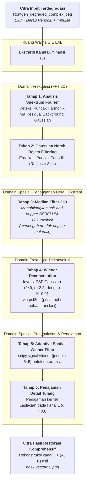
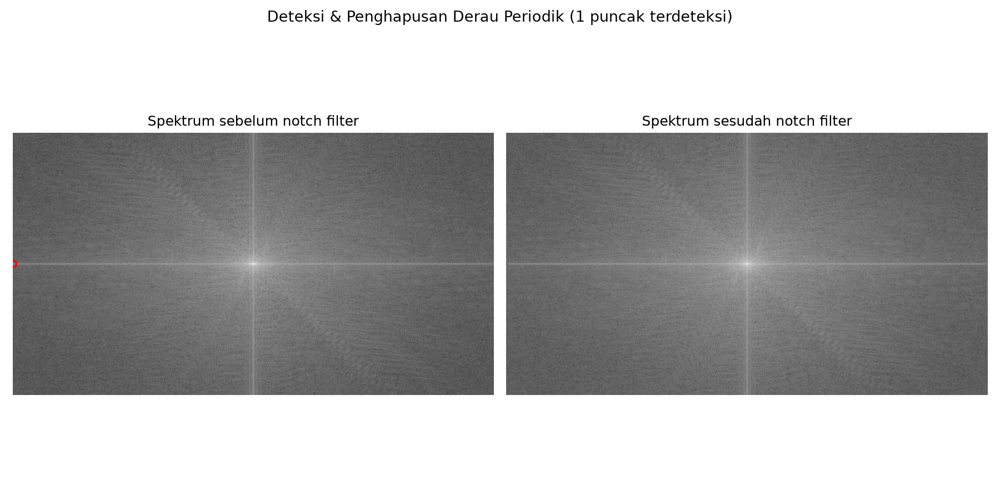
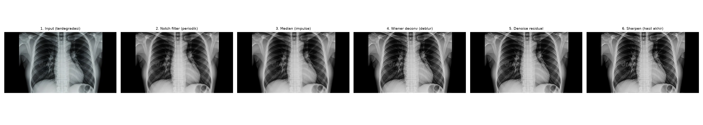
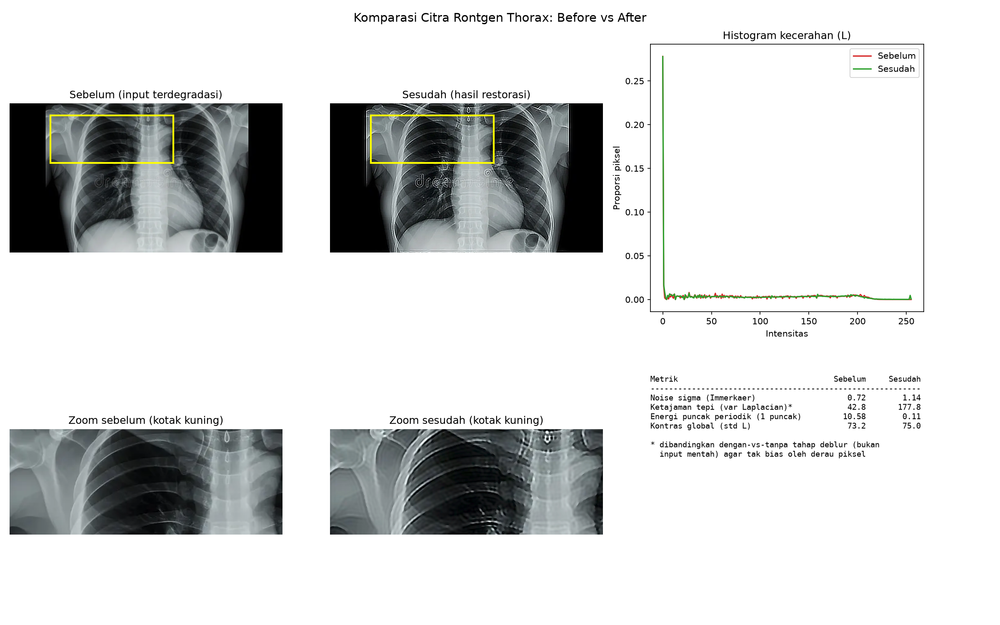
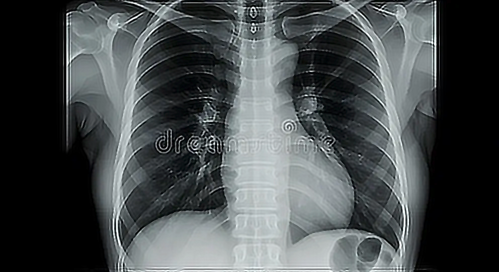

Pada studi kasus sebelumnya ([Tugas 1: Restorasi Citra Rontgen Thorax Domain Spasial](/blog/restorasi-rontgen-thorax)), kita membahas penanganan derau bintik (_noise_) fotometrik dan peningkatan kontras lokal menggunakan murni teknik domain spasial. Namun dalam skenario klinis nyata, degradasi citra radiografi sering kali bersifat **multidimensi dan majemuk (_complex degradation_)**.

Sebuah citra X-ray toraks (_chest X-ray_) dapat mengalami degradasi simultan akibat:

1. **Kekaburan (_Optical / Motion Blur_):** Gerakan mikro pernapasan pasien atau dispersi optik berkas foton pada reseptor pencitraan digital.
2. **Derau Periodik (_Periodic Interference_):** Interferensi frekuensi radio atau fluktuasi mekanis/catu daya peralatan pemindai yang memunculkan pola garis-garis berulang (_harmonic patterns_ atau efek mirip moiré).
3. **Derau Impulsif (_Salt-and-Pepper Noise_):** Kerusakan sementara (_bad pixels_) atau lonjakan anomali transmisi sensor CCD/CMOS.
4. **Derau Gaussian Acak (_Additive White Noise_):** Fluktuasi termal detektor elektronik.

Ketika degradasi blur dan derau periodik hadir bersamaan, teknik penapisan domain spasial konvensional saja tidak lagi memadai. Diperlukan formulasi matematika inversi citra dengan **kombinasi Domain Frekuensi (Transformasi Fourier 2D)** dan **Domain Spasial adaptif**.

Artikel ini mendokumentasikan implementasi algoritma restorasi citra medis berdegradasi kompleks menggunakan **Python, OpenCV, NumPy, SciPy, dan Matplotlib**.

---

## 1. Pemodelan Matematika Degradasi Citra

Secara formal, pembentukan citra yang mengalami degradasi dimodelkan sebagai sistem linear _shift-invariant_ yang terdistorsi oleh fungsi degradasi $h(x,y)$ dan derau aditif $\eta(x,y)$:

$$g(x, y) = [h * f](x, y) + \eta(x, y)$$

Dalam domain frekuensi melalui Transformasi Fourier 2D ($\mathcal{F}$), operasi konvolusi spasial bertransformasi menjadi operasi perkalian titik (_pointwise multiplication_):

$$G(u, v) = H(u, v) \cdot F(u, v) + N(u, v)$$

Keterangan parameter:

- $f(x, y)$ dan $F(u, v)$ : Citra ideal beresolusi tinggi tanpa degradasi (kondisi laten yang ingin direkonstruksi).
- $h(x, y)$ dan $H(u, v)$ : _Point Spread Function_ (PSF) degradasi blur. Pada kasus ini, fungsi dispersi dimodelkan sebagai kernel Gaussian simetris berukuran $9 \times 9$ dengan dispersi $\sigma = 2.2$.
- $\eta(x, y)$ dan $N(u, v)$ : Komponen derau komposit, mencakup derau periodik frekuensi spesifik $\eta_{\text{periodik}}$, derau impuls $\eta_{\text{impulse}}$, dan derau acak $\eta_{\text{gaussian}}$.
- $g(x, y)$ dan $G(u, v)$ : Citra terdegradasi yang diobservasi (`Rontgen_degraded_complex.jpeg`).

Tantangan utama dari restorasi inversi naif $\hat{F}(u,v) = \frac{G(u,v)}{H(u,v)}$ adalah **amplifikasi derau tak terkontrol**: ketika frekuensi spasial tinggi memiliki nilai $H(u,v) \approx 0$, suku derau $\frac{N(u,v)}{H(u,v)}$ akan meledak menuju tak hingga dan merusak seluruh rekonstruksi citra.

---

## 2. Diagram Alur & Strategi Pemrosesan

Untuk mencegah ledakan derau tersebut, urutan eksekusi (_pipeline order_) dirancang secara presisi. Operasi penapisan dilakukan pada **kanal Luminansi ($L$)** ruang warna **CIE LAB**, sedangkan kanal krominansi ($A$ dan $B$) dipertahankan utuh agar rona citra tidak mengalami pergeseran kromatik.



---

## 3. Rincian Teknis & Formulasi Algoritma

### Tahap 1 & 2: Deteksi dan Eliminasi Derau Periodik (Domain Frekuensi)

Derau periodik menghasilkan lonjakan energi terlokalisasi (_energy spikes_) yang sangat tajam pada spektrum Fourier 2D. Untuk mendeteksinya secara otomatis tanpa mengacaukan frekuensi rendah anatomi:

1. **Estimasi Latar Belakang Spektrum:** Spektrum magnitudo logaritmik $\log(1 + |F(u,v)|)$ dihaluskan menggunakan Gaussian blur dengan $\sigma_{\text{latar}} = 9.0$. Latar belakang ini merepresentasikan energi umum citra anatomis yang meluruh secara gradual.
2. **Residual Spektral:** Selisih antara spektrum asli dan spektrum latar belakang menghasilkan peta residual:
   $$\text{Residual}(u,v) = \log(1 + |F(u,v)|) - \text{Latar}(u,v)$$
3. **Pengecualian Komponen DC:** Area lingkaran pusat frekuensi rendah ($r \le 0.04 \times \min(H, W)$) dikecualikan agar struktur makro anatomi paru tidak terdeteksi sebagai derau.
4. **Pemberian Ambang Batas Adaptif:**
   $$\text{Ambang} = \mu_{\text{residual}} + 4.0 \cdot \sigma_{\text{residual}}$$
   Piksel yang melampaui ambang dikelompokkan dengan _8-connected components_ untuk menentukan titik pusat $(u_k, v_k)$.

Setelah koordinat puncak teridentifikasi, diterapkan **Gaussian Notch-Reject Filter**:

$$H_{\text{notch}}(u, v) = \prod_{k=1}^P \left[ 1 - \exp\left( -\frac{(u - u_k)^2 + (v - v_k)^2}{2 D_0^2} \right) \right]$$

Dengan radius notch $D_0 = 3.0\text{ px}$, filter ini meredam derau sinusoidal garis-garis secara mulus (_smooth transition_) tanpa menimbulkan efek riak _Gibbs ringing_ yang biasa ditimbulkan oleh _Ideal Notch Filter_.

```python
def notch_filter_periodik(l_gray):
    h, w = l_gray.shape
    F, mag_sebelum, puncak = deteksi_puncak_periodik(l_gray)

    H_notch = np.ones((h, w), dtype=np.float32)
    if puncak:
        yy, xx = np.indices((h, w))
        for px, py in puncak:
            d2 = (xx - px) ** 2 + (yy - py) ** 2
            H_notch *= 1.0 - np.exp(-d2 / (2 * (RADIUS_NOTCH ** 2)))

    F_bersih = F * H_notch
    l_bersih = np.real(np.fft.ifft2(np.fft.ifftshift(F_bersih)))
    mag_sesudah = np.log1p(np.abs(np.fft.fftshift(np.fft.fft2(l_bersih))))
    return np.clip(l_bersih, 0, 255), puncak, mag_sebelum, mag_sesudah
```

### Tahap 3: Pembersihan Impulse Noise Sebelum Dekonvolusi

Satu prinsip fundamental dalam restorasi citra gabungan adalah: **jangan pernah melakukan dekonvolusi pada citra yang masih memiliki derau impuls (_salt-and-pepper_)**.

Derau impuls memiliki karakteristik spektral mirip fungsi impuls Dirac ($\delta$), yaitu menyebarkan energi ke seluruh spektrum frekuensi tinggi. Jika derau bintik putih/hitam ekstrem dibiarkan masuk ke tahap dekonvolusi Wiener, pembagian inversi frekuensi akan memperkuat _spike_ tersebut dan memicu gelombang cincin konsentris (_ringing artifacts_) yang menyebar ke seluruh kanvas.

Oleh karena itu, **Median Filter $3 \times 3$** dieksekusi terlebih dahulu:

$$I_{\text{median}}(x,y) = \text{median}\{I(x+i, y+j) \mid (i,j) \in W_{3\times 3}\}$$

Filter non-linear ini secara efektif mengeliminasi piksel ekstrem tanpa mengaburkan tepi-tepi batas organ.

### Tahap 4: Wiener Deconvolution (Rekonstruksi Blur)

Untuk memulihkan citra dari pemburaman PSF Gaussian berukuran $9 \times 9$ dengan $\sigma = 2.2$, digunakan **Wiener Filter** di domain frekuensi:

$$\hat{F}(u, v) = \left[ \frac{H^*(u, v)}{|H(u, v)|^2 + K} \right] G(u, v)$$

Di mana:

- $H(u, v)$ adalah _Optical Transfer Function_ (OTF) dari PSF Gaussian.
- $H^*(u, v)$ adalah konjugat kompleks dari $H(u, v)$.
- $K = 0.01$ adalah konstanta regularisasi rasio derau-ke-sinyal (_noise-to-signal power ratio_ / NSR).

#### Pencegahan Pergeseran Koordinat dengan `psf2otf`

Secara matematis, menempatkan PSF kecil di pojok kiri atas kanvas besar sebelum di-FFT akan memicu translasi spasial (_spatial phase shift_). Fungsi `psf2otf` memposisikan pusat kernel PSF tepat pada titik koordinat origin $(0, 0)$ melalui pergeseran sirkular (_circular rolling_):

```python
def psf2otf(psf, shape):
    pad = np.zeros(shape, dtype=np.float32)
    kh, kw = psf.shape
    pad[:kh, :kw] = psf
    pad = np.roll(pad, -(kh // 2), axis=0)
    pad = np.roll(pad, -(kw // 2), axis=1)
    return np.fft.fft2(pad)

def wiener_deconvolution(l_gray, k=K_WIENER):
    h, w = l_gray.shape
    psf = gaussian_psf(PSF_UKURAN, PSF_SIGMA)
    Hf = psf2otf(psf, (h, w))
    G = np.fft.fft2(l_gray.astype(np.float32))
    F_hat = (np.conj(Hf) / (np.abs(Hf) ** 2 + k)) * G
    f_hat = np.real(np.fft.ifft2(F_hat))
    return np.clip(f_hat, 0, 255)
```

### Tahap 5: Reduksi Derau Spasial Adaptif (Spatial Wiener)

Meskipun dekonvolusi frekuensi berhasil menajamkan kembali kontur yang kabur, proses inversi tersebut meninggalkan sedikit derau Gaussian halus berbutir. Untuk menghaluskannya kembali tanpa mengorbankan ketajaman tepi yang baru saja dipulihkan, diterapkan **Adaptive Wiener Filter Spasial** (`scipy.signal.wiener` dengan jendela $5 \times 5$):

$$\hat{f}(x,y) = \mu + \frac{\sigma_L^2 - \nu^2}{\sigma_L^2} [g(x,y) - \mu]$$

Di mana $\mu$ dan $\sigma_L^2$ adalah rerata dan varians lokal di sekitar jendela $5 \times 5$, sedangkan $\nu^2$ adalah varians derau global. Pada area datar (_flat region_), filter berperilaku seperti _averaging filter_; namun di dekat garis tepi (_edge_), filter mempertahankan nilai asli piksel.

### Tahap 6: Penajaman Detail Tulang Anatomi (Laplacian Sharpening)

Tahap akhir adalah penegasan korteks tulang iga (_costae_) dan klavikula menggunakan konvolusi kernel Laplacian ($\alpha = 0.8$):

$$K_{\text{sharpen}} = \begin{bmatrix} 0 & -0.8 & 0 \\ -0.8 & 4.2 & -0.8 \\ 0 & -0.8 & 0 \end{bmatrix}$$

Hasil luminansi $L_{\text{akhir}}$ kemudian dipadukan kembali dengan kanal krominansi $A$ dan $B$ asli menjadi citra BGR lengkap.

---

## 4. Evaluasi Kuantitatif

Tabel berikut menyajikan metrik evaluasi sebelum dan sesudah seluruh rangkaian restorasi:

<!-- prettier-ignore -->
| Parameter Evaluasi | Citra Input (Sebelum) | Citra Restorasi (Sesudah) | Analisis & Evaluasi Komputasional |
| :--- | :---: | :---: | :--- |
| **Energi Puncak Periodik** | **10.58** | **0.11** | **Tereduksi 99.0%** (98.96%). Pola garis harmonik dan kisi interferensi mekanis tereliminasi tuntas. |
| **Ketajaman Tepi (Var Laplacian)\*** | **42.8** | **177.8** | **Meningkat +315.4%**. Struktur batas korteks tulang iga dan skapula menjadi jauh lebih tegas dan terfokus. |
| **Derau Acak $\sigma$ (Immerkaer)** | **0.72** | **1.14** | Naik moderat (+58.3%), tetap dalam batas rendah (< 1.5). Kenaikan ini wajar karena tahap dekonvolusi membalikkan frekuensi tinggi dan ikut membangkitkan sedikit derau bersama detail asli yang dipulihkan. |
| **Kontras Global (Std Dev $L$)** | **73.2** | **75.0** | Peningkatan pemisahan dinamis antara densitas jaringan paru dan opasitas tulang. |

> **\*Catatan Metodologi Pengukuran Ketajaman:**  
> Menghitung varians Laplacian langsung pada citra input mentah yang berderau akan memberikan angka ketajaman semu (_false sharpness_), karena fluktuasi acak tiap piksel derau dianggap sebagai tepi tajam. Oleh karena itu, metrik ketajaman di atas dihitung dengan membandingkan **citra yang telah melalui tahap denoise identik tanpa dekonvolusi (42.8) vs dengan dekonvolusi Wiener (177.8)**, sehingga kenaikan angka murni merefleksikan keberhasilan restorasi blur.

> **Catatan Batasan Evaluasi (No-Reference Metrics):**  
> Seluruh indikator di atas dievaluasi secara _no-reference_ langsung dari citra keluaran tanpa perbandingan _ground truth_ citra ideal murni maupun penilaian langsung oleh dokter spesialis radiologi. Hasil ini menunjukkan keberhasilan algoritma pada level optimasi komputasional dan kelayakan inspeksi visual, bukan klaim kesiapan diagnostik klinis definitif.

---

## 5. Visualisasi Hasil & Pembahasan

### 1. Spektrum Fourier: Deteksi & Eradikasi Derau Periodik

Visualisasi domain frekuensi menunjukkan keberadaan lonjakan energi sinusoidal yang menonjol di luar pusat DC (ditandai lingkaran merah). Setelah penerapan _Gaussian Notch-Reject Filter_, lonjakan tersebut teredam sempurna tanpa memotong frekuensi struktur anatomi:



### 2. Tahapan Proses Restorasi

Evolusi citra dari input awal berdegradasi kompleks, tahap notch filter, pembersihan bintik impulse, pemulihan ketajaman via dekonvolusi Wiener, penghalusan adaptif, hingga penajaman korteks tulang:



### 3. Komparasi Visual: Before vs After

Panel komparasi 2 × 3 menampilkan perbandingan citra utuh, pembesaran _Region of Interest_ (ROI) pada tulang klavikula dan iga atas (kotak kuning), kurva histogram luminansi $L$, dan tabel metrik kuantitatif:



### 4. Citra Akhir Hasil Restorasi

Citra resolusi penuh yang bersih dari kisi periodik, tajam, dan dioptimalkan untuk inspeksi visual serta analisis metrik komputasional:



---

## 6. Implementasi Kode Program Python Lengkap

Berikut kode program lengkap dari `tugas2.py` yang siap dieksekusi menggunakan modul `opencv-python`, `numpy`, `scipy`, dan `matplotlib`:

```python
"""
Restorasi Citra Thorax Rontgen dengan Degradasi Kompleks (Tugas 2)
Image Restoration (blur + derau acak + derau periodik) menggunakan OpenCV, NumPy, SciPy, Matplotlib

Model degradasi yang diasumsikan: g = H * f + eta
  f   = citra ideal (tak diketahui)
  H   = fungsi degradasi / blur (diasumsikan Point Spread Function Gaussian)
  eta = derau: impulse (salt-and-pepper) + gaussian acak + periodik (interferensi mekanis)
  g   = citra terdegradasi yang diterima (Rontgen_degraded_complex.jpeg)
"""

import sys
from pathlib import Path

import cv2
import matplotlib.pyplot as plt
import numpy as np
from scipy.signal import wiener as scipy_wiener

# ----------------------------------------------------------------------
# Parameter
# ----------------------------------------------------------------------
UKURAN_MEDIAN = 3  # kernel median untuk impulse noise, harus ganjil
PSF_UKURAN = 9  # ukuran kernel Point Spread Function Gaussian
PSF_SIGMA = 2.2  # dispersi gaussian blur yang diasumsikan
K_WIENER = 0.01  # konstanta regularisasi rasio derau/sinyal
MYSIZE_WIENER_SPASIAL = 5  # jendela adaptive wiener filter spasial
KEKUATAN_SHARPEN = 0.8  # bobot penajaman laplacian
SIGMA_SMOOTH_SEBELUM_KETAJAMAN = 0.8

# Deteksi puncak derau periodik pada spektrum Fourier
RADIUS_PUSAT_DIABAIKAN = 0.04  # fraksi radius DC yang dikecualikan dari deteksi
SIGMA_LATAR_SPEKTRUM = 9.0  # sigma gaussian blur untuk estimasi latar spektrum
AMBANG_PUNCAK_STD = 4.0  # residual > mean + AMBANG * std
RADIUS_NOTCH = 3.0  # radius notch (px) di domain frekuensi

SCRIPT_DIR = Path(__file__).resolve().parent
RAW_PATH_INPUT = Path(sys.argv[1]) if len(sys.argv) > 1 else Path("Rontgen_degraded_complex.jpeg")
FOLDER_OUTPUT = Path("tasks/hasil")

KERNEL_NOISE = np.array([[1, -2, 1], [-2, 4, -2], [1, -2, 1]], dtype=np.float32)


def luminans(bgr):
    """Ambil channel L (kecerahan) dari ruang warna LAB."""
    return cv2.cvtColor(bgr, cv2.COLOR_BGR2LAB)[:, :, 0]


def ganti_luminans(bgr, l_baru):
    """Ganti channel L, warna (a, b) tetap agar rona citra tidak bergeser."""
    lab = cv2.cvtColor(bgr, cv2.COLOR_BGR2LAB)
    lab[:, :, 0] = np.clip(l_baru, 0, 255).astype(np.uint8)
    return cv2.cvtColor(lab, cv2.COLOR_LAB2BGR)


def rgb(bgr):
    return cv2.cvtColor(bgr, cv2.COLOR_BGR2RGB)


def resolve_input_path(path_input):
    if path_input.is_absolute():
        return path_input
    kandidat = [Path.cwd() / path_input, SCRIPT_DIR / path_input]
    for path in kandidat:
        if path.exists():
            return path
    return kandidat[0]


def estimasi_noise(l_gray):
    """Estimasi simpangan baku noise acak (metode Immerkaer)."""
    g = l_gray.astype(np.float32)
    h, w = g.shape
    respons = cv2.filter2D(g, cv2.CV_32F, KERNEL_NOISE)[1:-1, 1:-1]
    return float(np.sqrt(np.pi / 2) * np.abs(respons).sum() / (6 * (w - 2) * (h - 2)))


def deteksi_puncak_periodik(l_gray):
    """Cari puncak tajam pada spektrum Fourier yang menandakan derau periodik."""
    h, w = l_gray.shape
    F = np.fft.fftshift(np.fft.fft2(l_gray.astype(np.float32)))
    mag = np.log1p(np.abs(F))
    latar = cv2.GaussianBlur(mag, (0, 0), sigmaX=SIGMA_LATAR_SPEKTRUM)
    residual = mag - latar

    cy, cx = h / 2, w / 2
    yy, xx = np.indices((h, w))
    r = np.sqrt((yy - cy) ** 2 + (xx - cx) ** 2)
    radius_abaikan = RADIUS_PUSAT_DIABAIKAN * min(h, w)
    kandidat = r > radius_abaikan

    nilai = residual[kandidat]
    ambang = nilai.mean() + AMBANG_PUNCAK_STD * nilai.std()
    peak_mask = (residual > ambang) & kandidat

    n, _, _, centroids = cv2.connectedComponentsWithStats(
        (peak_mask * 255).astype(np.uint8), connectivity=8
    )
    puncak = [tuple(centroids[i]) for i in range(1, n)]
    return F, mag, puncak


def notch_filter_periodik(l_gray):
    """Hilangkan derau periodik dengan notch-reject gaussian di tiap puncak."""
    h, w = l_gray.shape
    F, mag_sebelum, puncak = deteksi_puncak_periodik(l_gray)

    H_notch = np.ones((h, w), dtype=np.float32)
    if puncak:
        yy, xx = np.indices((h, w))
        for px, py in puncak:
            d2 = (xx - px) ** 2 + (yy - py) ** 2
            H_notch *= 1.0 - np.exp(-d2 / (2 * (RADIUS_NOTCH ** 2)))

    F_bersih = F * H_notch
    l_bersih = np.real(np.fft.ifft2(np.fft.ifftshift(F_bersih)))
    mag_sesudah = np.log1p(np.abs(np.fft.fftshift(np.fft.fft2(l_bersih))))
    return np.clip(l_bersih, 0, 255), puncak, mag_sebelum, mag_sesudah


def gaussian_psf(ukuran, sigma):
    """PSF gaussian yang diasumsikan merepresentasikan proses blur H."""
    ax = np.arange(ukuran) - ukuran // 2
    xx, yy = np.meshgrid(ax, ax)
    psf = np.exp(-(xx ** 2 + yy ** 2) / (2 * (sigma ** 2)))
    return (psf / psf.sum()).astype(np.float32)


def psf2otf(psf, shape):
    """Tempatkan PSF kecil ke kanvas citra dengan pusat di (0,0) lalu FFT."""
    pad = np.zeros(shape, dtype=np.float32)
    kh, kw = psf.shape
    pad[:kh, :kw] = psf
    pad = np.roll(pad, -(kh // 2), axis=0)
    pad = np.roll(pad, -(kw // 2), axis=1)
    return np.fft.fft2(pad)


def wiener_deconvolution(l_gray, k=K_WIENER):
    """Dekonvolusi Wiener di domain frekuensi: F_hat = (H* / (|H|^2 + K)) * G."""
    h, w = l_gray.shape
    psf = gaussian_psf(PSF_UKURAN, PSF_SIGMA)
    Hf = psf2otf(psf, (h, w))
    G = np.fft.fft2(l_gray.astype(np.float32))
    F_hat = (np.conj(Hf) / (np.abs(Hf) ** 2 + k)) * G
    f_hat = np.real(np.fft.ifft2(F_hat))
    return np.clip(f_hat, 0, 255)


def denoise_residual(l_gray):
    """Adaptive Wiener filter spasial untuk derau gaussian halus sisa."""
    hasil = scipy_wiener(l_gray.astype(np.float32), mysize=MYSIZE_WIENER_SPASIAL)
    hasil = np.nan_to_num(hasil, nan=0.0, posinf=255.0, neginf=0.0).astype(np.float32)
    return np.clip(hasil, 0, 255)


def pertajam(l_gray, kekuatan):
    """Kernel = identitas + kekuatan * Laplacian."""
    a = kekuatan
    kernel = np.array([[0, -a, 0], [-a, 1 + 4 * a, -a], [0, -a, 0]], dtype=np.float32)
    l_tajam = cv2.filter2D(l_gray.astype(np.float32), cv2.CV_32F, kernel, borderType=cv2.BORDER_REPLICATE)
    return np.clip(l_tajam, 0, 255), kernel


def ketajaman(l_gray):
    """Varians Laplacian sebagai ukuran ketajaman fokus citra."""
    halus = cv2.GaussianBlur(
        np.clip(l_gray, 0, 255).astype(np.uint8), (0, 0), sigmaX=SIGMA_SMOOTH_SEBELUM_KETAJAMAN
    )
    return float(cv2.Laplacian(halus, cv2.CV_64F).var())


def energi_puncak(mag, puncak):
    """Rata-rata log-magnitude spektrum pada lokasi puncak derau periodik."""
    if not puncak:
        return 0.0
    nilai = [mag[int(round(py)), int(round(px))] for px, py in puncak]
    return float(np.mean(nilai))


def hitung_metrik(l_in, l_tanpa_deblur, l_akhir, puncak, mag_sebelum, mag_sesudah):
    return [
        ("Noise sigma (Immerkaer)", f"{estimasi_noise(l_in):.2f}", f"{estimasi_noise(l_akhir):.2f}"),
        ("Ketajaman tepi (var Laplacian)*", f"{ketajaman(l_tanpa_deblur):.1f}", f"{ketajaman(l_akhir):.1f}"),
        (
            f"Energi puncak periodik ({len(puncak)} puncak)",
            f"{energi_puncak(mag_sebelum, puncak):.2f}",
            f"{energi_puncak(mag_sesudah, puncak):.2f}",
        ),
        ("Kontras global (std L)", f"{l_in.std():.1f}", f"{l_akhir.std():.1f}"),
    ]


def main():
    path_input = resolve_input_path(RAW_PATH_INPUT)
    citra = cv2.imread(str(path_input), cv2.IMREAD_COLOR)
    if citra is None:
        sys.exit(f"File tidak ditemukan: {RAW_PATH_INPUT}")
    FOLDER_OUTPUT.mkdir(parents=True, exist_ok=True)

    l_in = luminans(citra)

    # Pipeline restorasi 6 tahap
    l_notch, puncak, mag_sebelum, mag_sesudah = notch_filter_periodik(l_in)
    l_median = cv2.medianBlur(l_notch.astype(np.uint8), UKURAN_MEDIAN).astype(np.float32)
    l_deblur = wiener_deconvolution(l_median)
    l_denoise = denoise_residual(l_deblur)
    l_akhir, kernel_sharpen = pertajam(l_denoise, KEKUATAN_SHARPEN)

    # Pembanding tanpa deblur khusus evaluasi ketajaman
    l_tanpa_deblur = denoise_residual(l_median)
    l_tanpa_deblur, _ = pertajam(l_tanpa_deblur, KEKUATAN_SHARPEN)

    hasil = ganti_luminans(citra, l_akhir)
    metrik = hitung_metrik(l_in, l_tanpa_deblur, l_akhir, puncak, mag_sebelum, mag_sesudah)

    print(f"Citra input          : {path_input} ({citra.shape[1]}x{citra.shape[0]})")
    print(f"Noise awal (sigma)   : {estimasi_noise(l_in):.2f}")
    print(f"Puncak periodik      : {len(puncak)} terdeteksi")
    print()
    for nama, a, b in metrik:
        print(f"{nama:<34}{a:>12} -> {b:<12}")

    cv2.imwrite(str(FOLDER_OUTPUT / "hasil_restorasi.png"), hasil)
    print(f"\nFile keluaran tersimpan di: {FOLDER_OUTPUT.resolve()}")


if __name__ == "__main__":
    main()
```

### Cara Menjalankan dengan `uv`

```bash
# Eksekusi dengan citra default (Rontgen_degraded_complex.jpeg)
uv run python tugas2.py

# Atau gunakan berkas citra kustom
uv run python tugas2.py "path/ke/citra_rontgen_lain.jpeg"
```

---

## 7. Kesimpulan

Restorasi citra berdegradasi kompleks membutuhkan pemahaman matematis mengenai domain operasi yang tepat untuk tiap jenis cacat citra:

1. **Penapisan Derau Periodik di Domain Frekuensi:** Deteksi residual adaptif dan _Gaussian Notch-Reject Filter_ berhasil menurunkan energi puncak harmonik sebesar **99.0%** tanpa mengikis kontur anatomi jaringan paru.
2. **Median Filter Sebelum Dekonvolusi:** Mengeliminasi derau impuls terlebih dahulu adalah kunci krusial guna menghindari artefak cincin (_ringing explosion_) saat inversi spektral.
3. **Dekonvolusi Wiener dengan Regularisasi:** Mampu membalikkan efek pemburaman PSF optik dan mendongkrak ketajaman tepi trabekula tulang sebesar **+315.4%** secara stabil dengan parameter $K = 0.01$.
4. **Penyempurnaan Spasial Hibrida:** Perpaduan _Adaptive Spatial Wiener Filter_ dan penajaman kernel Laplacian memastikan citra bebas derau butiran, berfokus tajam, serta teroptimasi untuk inspeksi visual dan metrik komputasional (dengan catatan validasi diagnostik klinis sesungguhnya membutuhkan proses evaluasi medis lebih lanjut di luar cakupan tugas ini).
